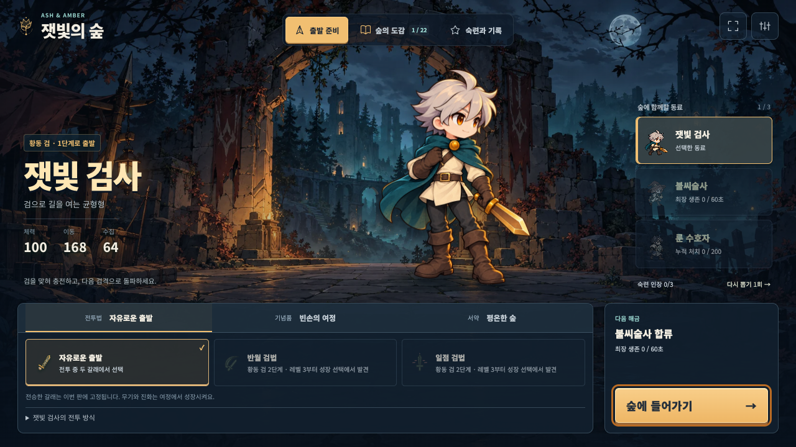
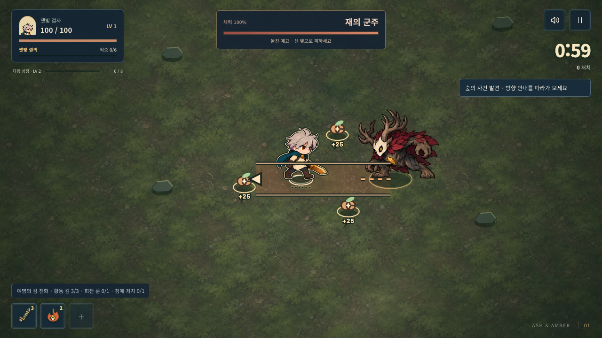

# Ash & Amber — 잿빛의 숲

A complete five-minute **2D cartoon survivor chapter** for the browser. Choose a companion, gather XP, evolve an automatic weapon and face the Ash Sovereign. The game uses Canvas 2D and Vite.

**[Play Ash & Amber](https://seung-won-yu.github.io/rune-drift-survivors/)** · [Play / development guide](./docs/survivor.md) · [Enemy design and verification](./docs/design/survivor-restart/12-ENEMY-ROLES.md)



The lobby image shows a fresh profile. Companions, combat styles and keepsakes unlock through play; locked choices show their actual requirements.



The combat image uses a development-only boss scenario to show the warning clearly; ordinary runs reach the sovereign after four minutes.

- **A deliberate action inside the fight:** Space or the separate touch button makes a short directional breakthrough with real primary-weapon hits and a 4.2-second cooldown. Growth now returns to combat for three seconds (four after evolution), preserving banked XP; owned support weapon families rotate between actual offers. These are playable experiments in combat decisions and rhythm, with an 18-run comparison per version and explicit limits on what testing proves. [Rules, references and verification](./docs/design/survivor-restart/49-COMBAT-DECISIONS-PROTOTYPE.md).

- **Sword growth changes the attack:** rank 3 adds one fresh-target follow-up, and rank 5 adds two. The full opening cleave remains; later cuts lock their own nearby target before contact, with matching regrip poses and alternating curved trails. An enemy takes at most one direct hit per combo, and Ash gains at most three charges. These milestones work with both sword branches and Dawn. [Rules and playtest limits](./docs/design/survivor-restart/50-BLADE-GROWTH-MILESTONES.md).

- **Fire and runes grow into different actions:** rank-3/5 secondary flames leap to one/two fresh targets, halving damage each time. Their initial explosion remains; leaps do not repeat it. Rank-3/5 runes stretch along ordinary travel and narrow at the sides, returning to a circle when stationary. Actual hit positions and short wakes share that shape. Cards and equipped descriptions disclose both the benefit and the gap. [Rules and verification limits](./docs/design/survivor-restart/51-FIRE-AND-RUNE-GROWTH.md).

- **A new visual direction from the lobby:** a ruined outpost at night frames the selected companion, with real starting stats on the left, party selection on the right and an equipment dock below. Compact top navigation connects preparation, collection and records. Slate-blue surfaces, amber commands and heavy Korean sans-serif type continue through growth, equipment comparison, pause, settings, rewards and results. The layout keeps departure visible while equipment and collection scroll internally. [Art direction, assets and verification](./docs/design/survivor-restart/47-OUTPOST-ART-DIRECTION.md).

- **Preparation that keeps its place:** tabs retain the companion stage and reading position, equipment changes keep decoded artwork, and companion pictures switch only when ready. Late or failed portrait requests cannot change the chosen companion or delay departure; keyboard focus stays with the choice and reduced motion skips the transitions. [Interaction and verification](./docs/design/survivor-restart/48-CAMP-SELECTION-CONTINUITY.md).

- **Decisions stay in the field:** growth and relic choices retain the battlefield and companion identity, put the real effect ahead of supporting text, and connect selected artwork to the equipped power without delaying movement. A quieter objective HUD and responsive result inventory keep earned equipment and the next playable build within reach. [Interface audit and verification](./docs/design/survivor-restart/46-FIELD-INTERFACE.md).

- **Crowd-clearing attack patterns:** charged swords fan outward and Dawn recalls five blades through the crowd; charged flames split into fragments, with secondary explosions after Comet; Grove releases an eight-way rune volley when its guard activates. Broader weapon silhouettes, brief crowd-break hit stop and denser reinforcements make growth visible in the fight. Enemy warnings remain above friendly attacks and reduced motion removes camera impulses. [Rules and verification](./docs/design/survivor-restart/45-COMBAT-SPECTACLE.md).

- **A revised combat flow:** nearby opening enemies shorten the empty start. Growth offers separate primary-weapon commitment, a rotating alternate weapon and utility; combat styles become available at weapon rank 2 / level 3. Four breakable fronts of weaker enemies create crowd-clearing opportunities; clearing a front recalls nearby earned XP and grants five seconds with fewer reinforcements. Between attacks, the boss closes into melee range so defensive runes can connect. This is a gameplay experiment, not proof of player enjoyment. [Rules, comparison and remaining questions](./docs/design/survivor-restart/44-RUN-FLOW-REWORK.md).
- **Combat with weight and momentum:** painted companions lean into the real strike, blades leave separated cut ribbons, flames carry short velocity-aligned wakes and break into hot chips, and runes leave a short trail behind their actual orbit. Ordinary creature hits compress briefly; confirmed kills get directional fragments. All motion follows the simulation clock and respects reduced motion. [Implementation and verification](./docs/design/survivor-restart/42-COMBAT-MOMENTUM.md).
- **An app-oriented game frame:** preparation, collection and records share persistent navigation; mobile collection uses index/detail navigation, and settings/fullscreen are available before play. The new outpost replaces the earlier rail and bottom-bar composition. [Original interaction and verification record](./docs/design/survivor-restart/40-GAME-APP-SHELL.md).
- **Decisions and the return:** growth cards put the actual effect first and show an illustrated receipt between consecutive levels. Results pair the companion summary with an earned inventory, with retry and preparation always reachable. [Original interaction and verification record](./docs/design/survivor-restart/41-DECISIONS-AND-RETURN.md).
- **A companion-led departure:** three new painted character portraits share the forest’s texture and lighting. Companion selection stays beside the character; the folio concentrates on combat style and keepsake choices, with readable ability summaries and a fixed departure button. [Design and verification](./docs/design/survivor-restart/28-COMPANION-PRESENTATION.md).
- **Focused preparation and readable growth:** combat style, keepsake and vow each open one bounded editor while their selected values stay visible. Starting health, speed and pickup range update beside the companion; keepsake candidates compare against the equipped item. Bookmark and Mist show their combined first-minute XP bonus and the bonus that remains afterward. The next reward or pinned goal links directly to its codex conditions. Growth cards distinguish new weapons, upgrades, specializations, evolution and healing with explicit labels and real before/after values. The pause journal puts equipped weapons first and folds secondary records. [Benchmarks and implementation](./docs/design/survivor-restart/35-FOCUSED-PREPARATION.md).
- **Goal-aware decisions:** a pinned Codex goal leads growth, relic selection and the pause journal with its own requirements. Material choices are marked separately from the target itself. The guide distinguishes preparation, an actual available offer, completion, a different chosen branch and full relic slots; discoveries are still recorded only when the journey ends.
- **See a combat style before choosing:** specialization offers include a comparison viewer with the same combat engine, character sprites and attack effects used in the field. Switch between the offered branches in a repeatable rank-2 encounter; the live journey stays paused and unchanged. Keyboard navigation, focus restoration, internal mobile scrolling and still scenes for reduced motion are supported.
- **Choices that fit and rewards you can read:** compact growth/relic cards scroll internally while reroll stays reachable. Cards show relevant evolution progress; earned feedback shows the real stat change, survives pause and carries the previous choice into chained levels. Results name newly earned items, and live boss thorns no longer show a safe recovery caption. [Ordinary boss victory and verification](./docs/design/survivor-restart/39-CHOICES-AND-EARNED-REWARDS.md).
- **Results that lead to a next choice:** a single reward ledger highlights one earned item and lists the rest once, each linked to its exact codex entry or mastery record. Specializations name the companion who can inherit them, including discoveries made with a secondary weapon. Returning from the codex restores the selected reward and reading position without granting it again. Runs with no new rewards show an honest next goal; defeats add a tip based on actual damage received. Retry and preparation stay fixed outside the scrolling journal. [Design and verification](./docs/design/survivor-restart/36-RESULTS-AND-NEXT-DEPARTURE.md).
- **A journey that keeps your place:** pause has direct equipment and screen/sound tabs, with owned weapons first and a fixed resume button. Results return from the codex to the same rewards and reading position; camp records remember expanded sections. Event offers show their real deadline, and relic cards put weapon requirements before the description. [Navigation and play verification](./docs/design/survivor-restart/38-JOURNEY-CONTINUITY.md).
- **Combat information with room to play:** health and companion ability share one panel; the XP track names the next level. Boss warnings, active objectives and notices flow without overlapping, and recovery guidance temporarily replaces the growth goal. Chest offers can be deferred without forfeiting the chest or changing its rewards. [HUD and choice verification](./docs/design/survivor-restart/37-COMBAT-HUD-AND-CHOICE-SAFETY.md).
- **Authored combat motion:** Ash, forest hounds and forest giants now have eight walking poses, separate attack anticipation/contact/recovery, recoil and collapse. Poses follow actual movement and attack clocks; warning ranges and damage rules stay intact. Ember and Grove now have separate release, absorption, hurt and defeat poses; the sovereign has authored charge, thorn-release and recovery actions. [Initial motion slice](./docs/design/survivor-restart/29-AUTHORED-COMBAT-MOTION.md) · [Companion, boss and material-hit pass](./docs/design/survivor-restart/31-COMPANION-BOSS-MATERIAL-MOTION.md).
- **Action before range diagrams:** compact blade strokes replace large overlapping sword arcs; flame heads/tails and thin flying crescents show projectile travel. Ordinary warnings omit crosshairs, labels, tethers and hound rails. Locked area boundaries remain, and the giant's real impact connects its club to the target through a brief ground break. [Visual correction](./docs/design/survivor-restart/30-ACTION-BEFORE-MARKERS.md).
- **Connected action and clearer priorities:** casts that face their actual target while moving, brief flask release glints, sparks at actual rune contacts and weapon-specific direct-kill marks connect attacks to their results. Foot dust follows actual travel and blast reactions point away from the explosion center without changing combat balance. Stationary canopy lighting adds forest depth; a central boss HUD and ready-to-evolve weapon slots clarify the next decision. [References and verification](./docs/design/survivor-restart/32-ACTION-CAUSALITY-AND-FOREST.md).
- **Creature-specific hits:** pale spores and cap crumbs, fur scratches, bark chips and brief sovereign mask cracks distinguish real contacts. Three small fragments per nearby hit keep warnings visible; reduced motion retains a static glint. All six actors stay below a 50MiB retained pose-canvas budget without enlarging painted source pixels.
- **Three companions:** a swordsman, a fast ember caster and a defensive rune guardian, with distinct starting weapons and dedicated walk/attack/hurt/defeat art. Survive 60 seconds to unlock the caster; earn 200 total kills to unlock the guardian.
- **Companion combat rhythms:** Ash earns an empowered slash through real blade contacts; Ember charges a stronger first firebolt by moving; Grove earns a temporary damage-absorbing shield through rune contacts. A compact HUD, weapon feedback and result totals show what the ability actually did.
- **Inherit a discovered combat style:** equip one recorded specialization for the companion's starting weapon, or keep a free start. The selected branch applies from weapon rank one, with no free levels or evolution. Each companion remembers its choice; the codex can prepare it directly. See the [character rhythm and inheritance record](./docs/design/survivor-restart/27-CHARACTER-RHYTHM-AND-LEGACY.md).
- **Three named minute encounters:** Root Warden's fixed slam, Thorn Fang's committed dash and Spore Crown's separated poison blooms. They enter in order from minutes one, two and three, waiting for an active champion and its reward window to finish. Defeat one to recall nearby XP and reduce ordinary reinforcements for six seconds; the four-minute sovereign deadline remains fixed.
- **Six specialization paths:** choose a wide or focused sword, spreading fire or concentrated explosions, and close defense or a distant rune orbit. Each weapon keeps one path for the run, alongside its evolution.
- **Six relics, two optional objectives:** hold the altar for ten seconds or accept an eighteen-second chest curse to pick a run-long relic. Discoveries persist; relic bonuses reset on retry; explicitly selected inheritance is reapplied once.
- **Try another build:** results highlight first discoveries and let you prepare another specialization for the same companion. The saved goal marks actual choices without granting upgrades. See the [replay experiment record](./docs/design/survivor-restart/19-REPLAY-EXPERIMENTS.md).
- **Informed detours:** inspect the exact altar/chest reward candidates before taking the risk. Offers stay fixed, and relic cards explain current-weapon links, future weapon requirements and burning specialization synergy. See the [choice design and research](./docs/design/survivor-restart/18-RISK-REWARD-CHOICES.md).
- **Three evolutions:** piercing Dawn Blade, Ash Comet (explosions or stronger specialized burning) and repelling Moonlit Ring. Pause to inspect recipes; ready evolutions appear at the next level-up.
- **Combat rhythm:** alternating pushes and brief collection windows, with eight seconds of reduced ordinary reinforcements after a weapon evolution. Existing enemies remain dangerous; the boss still arrives at four minutes. See the [pacing record](./docs/design/survivor-restart/17-COMBAT-PACING.md).
- **A final encounter:** the sovereign arrives at four minutes with marked charges and thorn volleys. A boss kill wins; surviving five minutes without a kill is recorded separately.
- **Three enemy roles:** mushrooms leave brief, warned spore zones; hounds commit to a marked dash lane; tree giants wind up a fixed-area slam. Enemy composition changes over the five-minute journey, with bounded simultaneous threats.
- **Collectible artwork:** distinct repository SVG illustrations connect keepsakes, growth choices, relics, the codex and real first-discovery rewards. Missing entries retain their silhouettes; opening a page never grants discoveries.
- **A lobby codex:** collect 22 companion, specialization, evolution, relic and keepsake entries. Category progress, missing-entry hints and evolution recipes turn existing saved discoveries into visible collection goals. The codex stays within the viewport: its heading and navigation stay fixed while the collection and details scroll inside. The departure and result actions stay outside their scrolling content. See the [collection and preparation design](./docs/design/survivor-restart/22-CODEX-AND-PREPARATION.md).
- **Collection goals and choice control:** pin an undiscovered specialization, evolution or relic in the codex; preview the companion, inheritance changes and any replaced goal before selecting. A tracked entry leads straight to preparation. Follow actual requirements and highlighted offers during the run. Reroll growth choices once per run while preserving ready evolutions.
- **Companion mastery and an optional vow:** earn three seals with each companion by trying both starting-weapon paths, evolving that weapon and defeating the sovereign. Completed mastery grants one extra reroll for that companion. After a first victory, opt into Deep Mist: +15% enemy HP, incoming damage and XP, with separate companion victory records. See the [progression design and tests](./docs/design/survivor-restart/23-COLLECTION-MASTERY-AND-VOWS.md).
- **Four forest challenges and visible preparation:** pick one starting keepsake before departure. Complete an altar, record two specializations, defeat the sovereign, or collect three distinct combat discoveries to earn keepsakes. The new First Light Bookmark grants +20% collected XP for the first 60 seconds; the other keepsakes offer health/movement/collection tradeoffs.
- **Reasons to return:** companion unlocks, recent journeys, per-character records, discovered evolutions and a damage breakdown. Records are local to the current browser, with graceful storage failure handling.
- **Informed recovery choices:** level-up screens show current health and the actual health after recovery, with a subtle highlight for available recovery at low health.
- **Contact feedback from the first weapon:** directional hit sparks, brief enemy compression, directional defeat motion and layered contact sounds. Combat timing and damage are unchanged; reduced motion keeps contact markers without recoil. See the [impact pass](./docs/design/survivor-restart/14-IMPACT-FEEL.md).
- **Attack weight:** four sword phases (anticipation, contact, follow-through and settling), character-specific casting, subtle idle breathing and a brief evolution celebration; evolved contact ornaments and sound layers; a bounded elite-defeat marker and finishing sound. See the [attack-weight record](./docs/design/survivor-restart/15-ATTACK-WEIGHT.md).
- **Distinct player damage:** incoming-direction marks, brief body recoil, real HP-loss readout and trail, a steady invulnerability marker, and a foreground hurt sound. Movement and damage rules stay unchanged. See the [research and implementation](./docs/design/survivor-restart/16-PLAYER-DAMAGE-FEEDBACK.md).
- **Combat readability and motion:** the companion stays above friendly effects and overlapping enemies; every enemy warning edge stays above the action. Travel-synced steps, grounded companion frames and gradual enemy windups add movement while dense fights show fewer floating numbers. See the [readability and motion record](./docs/design/survivor-restart/21-COMBAT-READABILITY-MOTION.md).
- **Visible weapon growth:** the selected specialization and evolution keep their collection artwork in the HUD and later upgrades. Sword growth previews include the actual before/after attack interval; Ash's Dawn evolution also names the charged five-way return. Both carry through to the earned receipt. Small fixed sword, comet and crescent engravings distinguish evolved attacks; the chosen branch remains visible. See the [growth presentation record](./docs/design/survivor-restart/25-GROWTH-VISUAL-IDENTITY.md).
- **Readable field decisions:** spores visibly bloom when damage becomes active; the existing giant footprint warms before impact. Healing fruits show direction, distance and their final ten seconds, including a matching field label. No larger warning areas or new damage rules. [Field readability verification](./docs/design/survivor-restart/43-FIELD-READABILITY.md).
- **Boss hit readability:** the monarch's projectiles use barbed bark silhouettes and short ember wakes. Its health meter shows the remaining percentage and a brief band of recent real damage; each hit expires independently, freezes on pause and becomes immediate under reduced motion. Victory discoveries use completion copy.
- **Build-aware guidance:** Ember's ability describes the selected fire specialization. Coal previews show the current burn change (12→18, or 22→33 after evolution), and equipped records show the active value. Evolution guidance follows owned weapons and explains when a new weapon is needed for the next path.
- **Readable feedback:** three optional healing fruits, separate weapon sounds, enemy defeat reactions, keyboard/touch controls, pause, mute and reduced-motion support.

## Run locally

Use **Node.js 22** (the version used by CI) and npm.

```sh
npm ci
npm run dev
```

Open **[the local game](http://127.0.0.1:5173/)**. Move with WASD/arrows or the touch stick. Attacks are automatic; use Space/the right touch button for a directional breakthrough, Escape/P to pause and 1–3, Enter or a card to choose an upgrade. No backend, account, or environment secrets are required.

## Verify and deploy

```sh
# Core rules and browser scenarios (installed Chrome locally)
npm run qa:survivor

# GitHub Pages build, both entry URLs and saved-progress continuity
GITHUB_PAGES=true npm run build
npm run qa:survivor:production
```

For CI-style browser checks, run `npx playwright install chromium` and prefix the QA commands with `CI=true`. Optional real-time runs and balance diagnostics are documented in the [development guide](./docs/survivor.md). Generated screenshots and diagnostics stay in ignored `output/` and `test-results/` directories. Browser checks do not establish physical-phone performance or human playtest results.

Pushes to `main` run survivor QA and the Pages production checks before publishing `dist/` through GitHub Actions. Both the root URL and the existing `/survivor/` URL load the same game module. Keep both HTML shells in sync when changing the static HUD. The `ash-profile-v1` storage key and origin are unchanged, so existing companion unlocks, discoveries, records and preparation choices remain available.

## Repository

- `src/survivor/`: game rules, Canvas rendering, controls, audio and interface.
- `index.html` and `survivor/index.html`: current game and compatible existing entry.
- `public/art/survivor/` and `public/fonts/`: game artwork and self-hosted Korean font.
- `scripts/survivor-*`: unit, browser, production and balance checks.
- `docs/survivor.md`: play and development guide.
- `docs/design/survivor-restart/`: current chapter design and historical verification records.

The former React/Three.js Rune Drift prototype has been removed from the active source, dependencies, tests and deployment. It remains recoverable from Git history before the retirement commit; no separate legacy game is published. Older design records describe their original release checks and are historical evidence, not current setup instructions. See the [retirement record](./docs/design/survivor-restart/33-LEGACY-RETIREMENT.md) and [asset credits](./ASSET_CREDITS.md).
