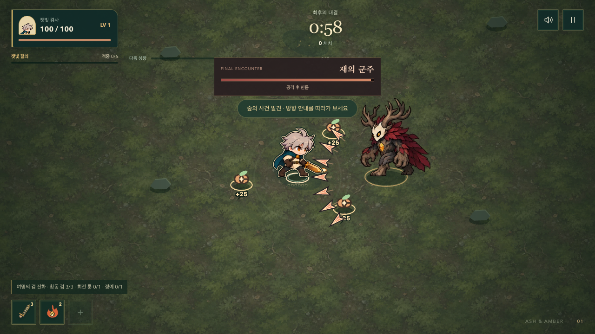
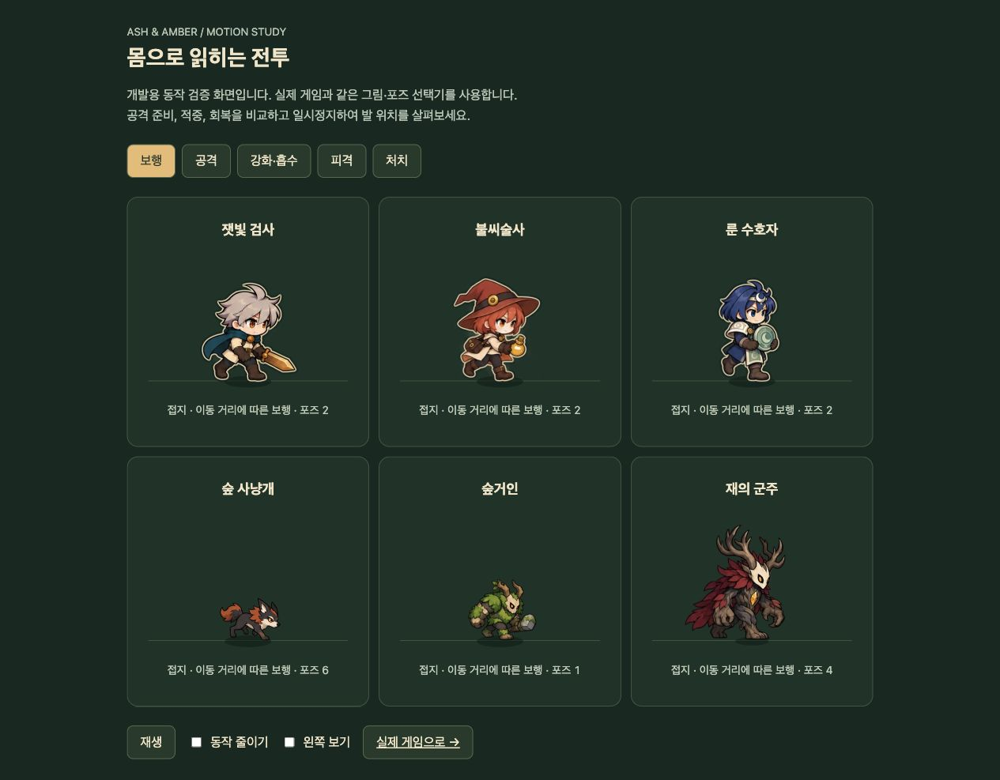
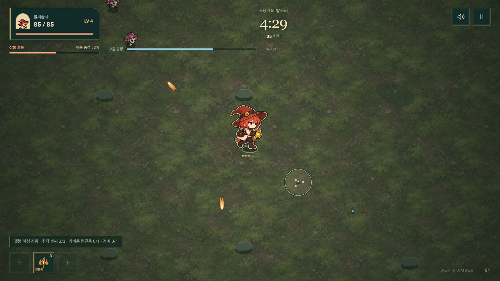

# 동료 모션 → 군주 액션 → 소재별 피격

2026-10-12. 큰 범위 도형을 늘리지 않고 몸동작과 실제 투사체를 읽기 쉽게 만든다. 사용자가 요청한 세 단계를 순서대로 구현했다.

## 동료

- 불씨술사: 보행 8, 기본 발사 4, 강화 발사 4, 피격 4, 쓰러짐 4. 기존 호박빛 병과 복장을 유지했다. 탄이 이미 발생한 순간부터 팔을 뻗은 발사 자세 → 반동 → 회복으로 이어진다.
- 룬 수호자: 보행 8, 룬 접촉 4, 흡수 4, 피격 4, 쓰러짐 4. 방어가 완전히 막은 피해는 흡수 자세, 실제 체력이 감소한 피해는 피격 자세를 쓴다. 보호막 유지 시간 동안 캐릭터를 멈춰 놓지 않는다.
- 동료가 검을 추가 획득했을 때는 실제 검 적중 경계 0.18초 전까지 준비 자세를 유지한다. 기본 공격·성장·흡수량·해금·저장은 바꾸지 않았다.

## 군주

24개 원화로 이동 4, 등장 2, 돌진 준비 2·발동 2·복귀 2, 가시 준비 2·발사 1·회복 2, 격노 이동 2, 피격 2, 쓰러짐 3을 연결했다.

공격 자세가 피격보다 우선한다. 실제 `pattern.age`와 `fired`를 읽으며 돌진/가시가 발생하기 전에 발동 자세를 보여 주지 않는다. 보행도 실제 추적 이동 거리를 누적하며 멈춘 보스는 제자리 걸음을 하지 않는다. 죽은 군주는 승리 연출 시계로 쓰러지고 사라진다.

가시는 실제 위치와 속도 방향을 따라가는 뿌리 파편이다. 작은 발사 조각과 짧은 꼬리를 더하고 기존 발사 확장 원을 없앴다. 원래 예고 영역·회피 시간·탄 수·피해·격노 규칙은 유지한다.

위 캡처는 군주 개발용 장면이다. 일반 플레이에서는 4분 후 군주가 등장한다.

## 피격 소재

- 버섯: 부드러운 갓 조각과 작은 밝은 포자.
- 사냥개: 짧은 긁힘과 갈색 털 조각.
- 거인: 단단한 껍질 조각과 이끼색 파편, 작은 몸 반동.
- 군주: 잠깐 보이는 가면 균열과 마른 망토 조각. 균열은 영구 손상이나 다른 공격 범위를 뜻하지 않는다.

실제 `impact.at/angle`만 사용한다. 공격 중인 적의 자세를 끊지 않으며, 가까운 적당 조각 3개로 제한한다. 밀집 전투의 먼 적은 적중 흔적만 남긴다. 모션 감소에서도 흔적은 보이지만 파편 이동은 없다. 추가 난수·판정·지연·피해는 없다.

## 자산과 추출

새 WebP 세 장은 합계 1,566,318바이트(약 1.49MiB), 각각 1024×1536 RGBA다. 기본 제공 imagegen으로 기존 동료/군주를 참고해 만들었고, 원본 크기·알파를 유지해 WebP로 변환했다. [정확한 프롬프트와 저장 경로](../../../public/art/survivor/COMPANION-BOSS-PROMPTS.md).

균일 격자를 가정하지 않고 실제 알파 경계를 측정했다. 군주의 넓은 손과 쓰러진 몸도 잘리지 않는다. 네 프레임의 빈 모서리에 걸친 이웃 그림 조각만 캐시 추출 시 제외하며 원본 파일은 유지한다. 발 기준과 원화 배율은 공격·웅크림·쓰러짐에도 일정하다.

이 화면은 개발용 동작 비교다. [로컬 연구실](http://127.0.0.1:5173/docs/design/survivor-restart/motion-lab/index.html)에서 공격·강화/흡수·피격·쓰러짐, 좌우 방향, 일시정지와 모션 감소를 볼 수 있다.

## 검증과 비용

- 단위 검사 149개 통과. 동료 발사/흡수/체력 손실 우선순위, 군주 돌진·가시 발사 경계, 소재 구분, 모션 감소, 상태 불변을 포함한다.
- 관련 브라우저 검사 26개 통과. 12장 필수 전투 이미지 로딩, 새 원화 각각의 로딩 지연, 발 접지·좌우 반전·밝은 피격 그림, 세 화면의 보스와 밀집 전투, 경고 가림 방지와 실제 무기 접촉을 확인했다.
- 독립 검토에서 최초 캐시가 약 96MiB인 점을 발견했다. 원본보다 큰 캐시를 만들지 않도록 바꿔 실제 유지 캔버스의 명목 RGBA 용량을 **48.49MiB**로 줄였다. 50MiB 상한 검사를 추가했다. 일반·피격 그림은 출발 전에 준비하므로 전투 중 첫 적중/처치에도 새 캔버스를 할당하지 않는다.
- 캐시 수정 후 관련 브라우저 10개 재검증 통과. 1280×720, 390×844, 740×360의 밀집 전투 각 12초: 프레임 간격 p95 16.7ms, 50ms 초과 0.
- Pages용 빌드와 production smoke 통과. 새 자산 세 장을 포함한 필수 경로, 도감 22항목, 시작/일시정지, 잠긴 성장, 프로덕션에서 개발용 QA API 제거를 확인했다.
- 불씨술사 일반 규칙 30.15초 진단: 35처치, 레벨 4, 체력 85, 고유 능력 9회, 실행 오류 0. 입력 드라이버가 이동/선택을 수행했으며 피해·경험치를 강제로 바꾸지 않았다. 이 진단은 캐시 해상도 최적화 전에 실행했다.

명목 캐시 수치는 원화 디코드, 임시 마스크, GPU 복사본과 다른 UI/배경 메모리를 포함하지 않는다. 데스크톱 자동 브라우저 검사만으로 물리 휴대폰의 시작 메모리·성능이나 사람이 느끼는 타격감을 단정하지 않는다.

## 배포

전체 GitHub Actions와 공개 Pages의 새 자산·실행 확인 후 결과를 여기에 기록한다. 기존 배포는 새 원화가 반영되기 전까지 유지된다.
