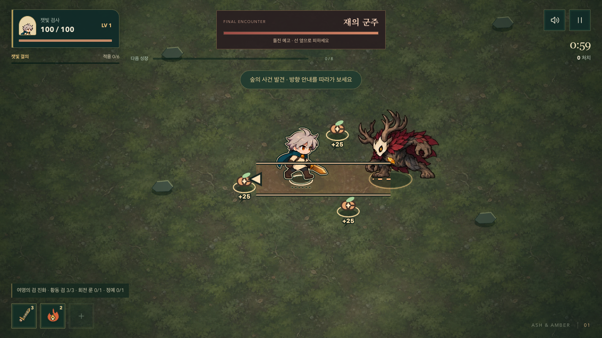
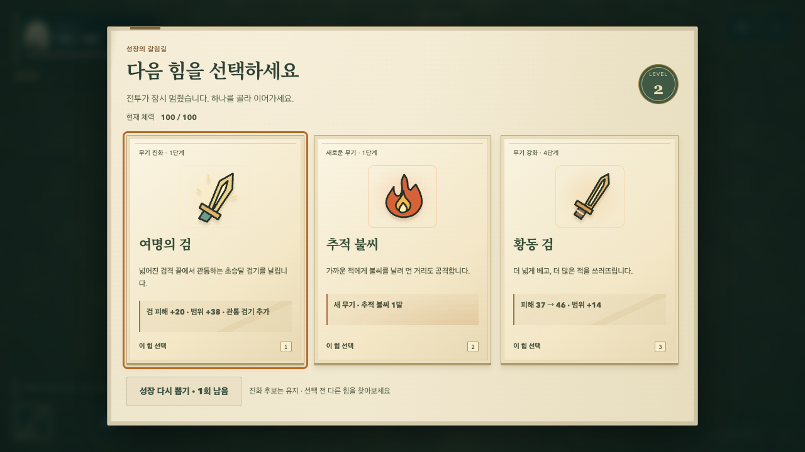
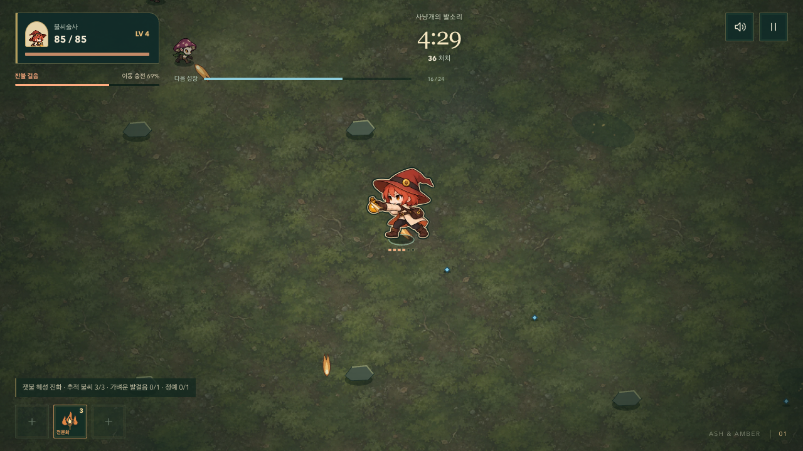
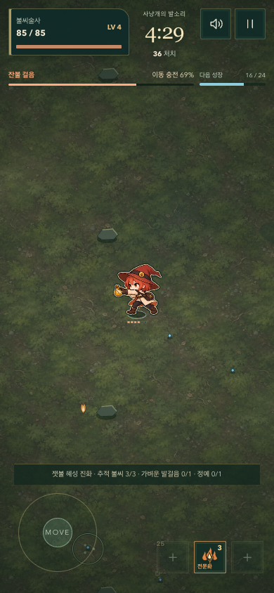
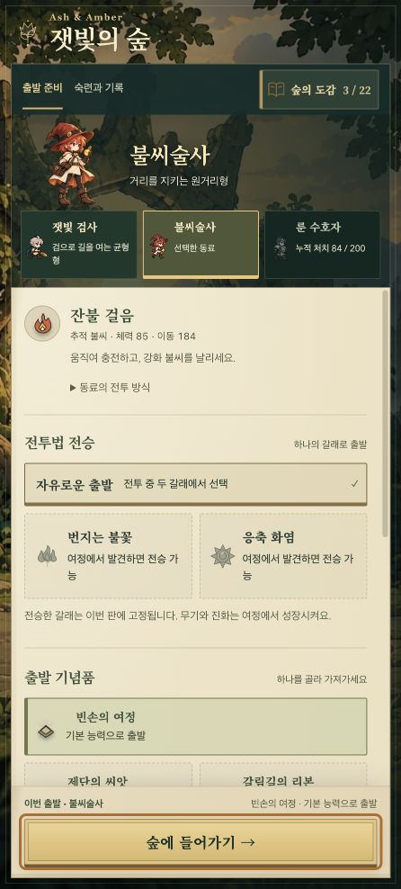

# 행동의 연결과 숲의 깊이

2026-10-13. 기존 동료·군주 원화와 숲/종이/잉크 방향을 유지하며, 발사–접촉–처치의 연결과 전투 중 시선 순서를 보완한다. 큰 범위 도형이나 지속 화면 흔들림을 늘리지 않는다.

## 벤치마크 근거

공식 자료를 직접 열어 확인했다. 아래의 적용은 원문을 이 프로젝트에 옮긴 설계 판단이며, 다른 게임의 재미나 성과를 보장하는 주장은 아니다. 확인일: 2026-10-13.

| 자료 | 실제 자료에서 확인한 점 | 이번 적용 |
| --- | --- | --- |
| [Supergiant — Hades Nighty Night](https://www.supergiantgames.com/blog/hades-the-nighty-night-update-patch-notes/) | 적중 효과를 정돈하고 방향성을 더했다. 처치 효과를 갱신하고 피격 화면 효과의 시야 방해를 줄였다. | 실제 방향을 따르는 작은 불씨 발사 흔적, 실제 룬 접촉점의 섬광. 넓은 추가 장막·원·표적 연결선은 사용하지 않는다. |
| [Supergiant — Welcome to Hell](https://www.supergiantgames.com/blog/hades-welcome-to-hell-update-patch-notes/) | 중요한 부활 표현을 명확하고 극적으로 다듬으면서 반복 번개 표현은 낮추었다. 활 차지 뒤 복귀도 별도로 개선했다. | 일반 직접 처치는 짧은 무기별 마무리, 정예·군주는 기존 강한 격파 표현을 유지한다. 모든 타격을 같은 강도로 강조하지 않는다. |
| [Squirrel Eiserloh — GDC 2016, Juicing Your Cameras with Math](https://media.gdcvault.com/gdc2016/Presentations/Eiserloh_Squirrel_JuicingYourCameras.pdf) | 카메라 충격의 축적·감쇠, 재현 가능한 노이즈와 절제를 설명한다. | 이번에는 추가 카메라 흔들림을 넣지 않는다. 기존 행동 시계를 읽는 짧은 효과만 쓰고 모션 감소에서는 위치·형태를 정지시킨다. |
| [poncle — Vampire Survivors 공식 Steam 소개](https://store.steampowered.com/app/1794680/Vampire_Survivors/) | 간결한 시간 생존 조작, 선택을 통해 빠르게 강해지는 흐름과 초반 소수 무기 집중을 설명한다. | 새 조작/성장 시스템을 더하기보다 이미 달성한 진화 조건을 무기 슬롯에서 즉시 보여 준다. |
| [Supergiant — UI Illustrator for Hades II](https://www.supergiantgames.com/blog/job-opportunity-ui-illustrator-for-hades-ii/) | 일관된 아이콘·화면 삽화와 플레이/성능 요구를 함께 다루는 제작 범위를 설명한다. | 무기 아이콘과 성장 수치 블록을 같은 잉크 색 계열로 묶는다. 인터페이스 구조는 유지한다. |

[Vlambeer 발표자의 공식 페이지](https://www.jwaaaap.com/)에서 원본 ‘The Art of Screenshake’ 링크를 확인했다. 영상 본문/자막은 요청 제한으로 확인하지 못했으므로 영상의 세부 내용은 인용하지 않는다. 기술 판단에는 위의 직접 열람한 GDC 슬라이드를 사용했다.

## 구현

- **불씨 발사:** 실제 첫 탄이 발생한 좌표·방향을 기록하고 손 앞에 0.12초의 작은 밝은 궤적을 그린다. 강화·진화 불씨는 짧은 갈래를 구분한다. 같은 발사의 여러 탄마다 효과를 쌓지 않는다. 불씨술사는 이동 중에도 발사 순간 실제 대상을 바라보고 복귀 시 이동 방향을 따른다. 이동·판정 방향은 유지하며 검격·피격·패배가 시작되면 해당 자세가 우선한다.
- **룬 접촉:** 실제 충돌한 룬 좌표에 0.14초의 작은 접선 섬광을 둔다. 적과 룬을 선으로 연결하지 않는다. 기존 적당 0.4초 타격 간격·밀어내기 방향은 그대로다.
- **처치 마무리:** 직접 검/불/룬 처치에만 각각 짧은 절단선·식는 불씨·닫히는 마름모를 쓴다. 기존 pop 효과를 대체하므로 장식 수가 중복되지 않는다. 연소나 유물 처치는 중립 표현을 유지한다.
- **숲:** 월드 좌표에 고정된 따뜻한 나뭇잎 사이 빛과 차가운 그늘을 한 번 구운 1024px 타일로 더했다. 캐릭터를 따라가는 범위처럼 보이지 않는다. 돌의 어두운 윤곽/따뜻한 윗면을 배우·아이콘의 잉크와 연결한다. 전경 장식으로 공격·경고를 가리지 않는다.
- **보스 HUD:** 넓은 화면의 중앙 상단을 군주 체력/행동에 할당한다. 남은 시간은 고정된 일시정지 버튼 아래에 작게 둔다. 좁은 세로/가로 화면의 기존 배치를 유지한다.
- **성장:** 조건을 충족한 무기 슬롯에 ‘진화 가능’을 표시하고 실제 진화 선택 뒤 해제한다. 강화 카드 효과 수치 블록은 검/불/룬/회복 계열의 얇은 잉크색과 문양으로 구분한다.

효과는 기존 120개 장식 상한 안에서 생기며 상한에 도달해도 공격은 정상 발사된다. 판정·피해·해금·저장·밸런스는 변경하지 않았다. 숲 타일의 명목 RGBA 비용은 4MiB이며 GPU 복사본/브라우저 내부 비용은 별도다. 전투 중 타일을 재생성하거나 Canvas filter를 실행하지 않는다.

## 검증

- 핵심 규칙 검사 157개 통과. 실제 발사/룬 접촉점, 장식 상한 도달 시 공격 유지, 연소와 직접 처치 구분, 조건 충족만으로 바뀌는 진화 슬롯을 포함한다.
- 관련 브라우저 검사 27개 통과. 3화면의 보스 상태/비겹침, 성장·진화, 캐릭터/위험 표시 가림 방지, 실제 좌우 발사 위치·컴팩트한 밝은 흔적, 실제 무기 접촉과 일시정지를 확인했다. 배경 가장자리의 작은 래스터화 차이와 밝은 발사 흔적을 구분해 픽셀 검사를 했다.
- 1280×720 / 390×844 / 740×360 밀집 전투 각 12초: p95 16.8 / 16.7 / 16.7ms, 50ms 초과 프레임 각각 0. 데스크톱 자동 브라우저 결과이며 실제 휴대폰 측정은 아니다.
- Pages 빌드와 production smoke 통과: 필수 자산, 도감/진화 조합, 잠긴 성장, 시작/일시정지, 개발용 API 제외; 오류/요청 실패 0.
- 독립 검토에서 군주 사망 직후 효과 시계가 멈추는 문제를 발견했다. 새 세 효과는 종료 연출 시계를 사용해 만료하도록 수정했고 실제 군주 처치 회귀 검사로 확인했다. 재검토에서 추가 결함은 발견하지 못했다.
- 일반 규칙의 불씨술사 자동 이동 진단을 30.5초 실행했다: 36처치, LV 4, 체력 85/85, 브라우저 오류 0. 좌우 발사 방향과 일시정지/복귀를 별도로 재검증했다. 실제 사람 조작 평가는 아니다.
- 추가 독립 검토에서 발사 다음 틱에 검격/피격이 시작될 때 병 앞 표식이 남는 문제를 발견했다. 현재 자세에 맞춰 짧은 방향 표식으로 전환하도록 수정하고 회귀 검사 및 재검토를 완료했다.
- 최신 실행 커밋의 전체 원격 검사와 공개 검증도 완료했다. 상세 결과는 아래 배포 항목에 기록했다.

## 요구사항 최종 대조

| 요구 | 확인한 구현·증거 | 판정 |
| --- | --- | --- |
| 벤치마크를 실제 개선으로 연결 | 위 5개 공식/발표 자료의 확인 내용과 적용 판단을 분리했다. 확인하지 못한 영상은 근거로 사용하지 않았다. | 충족 |
| 큰 범위 도형보다 동작·투사체를 명확히 | 실제 첫 탄/룬 충돌 좌표에만 짧은 표식을 추가했다. 좌우 이동 반대 방향 발사, 픽셀 범위, 장식 상한 검사를 통과했다. | 충족 |
| 동료 → 보스 → 몬스터 피격 | [31번 기록](./31-COMPANION-BOSS-MATERIAL-MOTION.md)의 여섯 배우 원화와 실제 행동 시계를 유지한다. 최신 수정은 피격/검격 우선권과 종료 효과 만료까지 검사했다. | 충족 |
| 전장과 UI의 시각적 일관성 | 고정 숲 빛·돌 윤곽, 무기 계열 성장 수치, 진화 준비 표시, 보스 중심 HUD를 실제 화면과 3개 화면 크기에서 확인했다. | 충족 |
| 기존 조작·진행·저장 유지 | 전투·UI 표현만 변경했다. 핵심 157개, 관련 브라우저 검사, 일시정지/복귀·모션 감소·Pages용 실행 검사를 통과했다. 전체 원격 검사와 공개 실행도 아래 배포 기록으로 확인했다. | 충족 |
| 실제 움직임을 확인할 결과물 | 정상 규칙 자동 입력으로 38.02초 실행, 46처치·LV 5·체력 85·오류 0. 마지막 15초의 무음 영상과 데스크톱/세로 화면을 전달했다. | 충족 |
| 메인 반영 및 공개 전달 | 실행 커밋 `74f50fb`를 메인에 푸시했다. 공개 배포 파일·실행 검증도 아래 배포 기록으로 확인했다. | 충족 |

보스 캡처는 개발용 상태다. 일반 플레이에서는 4분에 군주가 등장한다.

자동 검사는 가독성의 구조적 조건과 성능을 확인하지만 사람의 타격감/재미 평가는 대체하지 않는다.

일시정지 대화상자만 캡처에서 숨겼다. 전투 객체와 규칙은 그대로이며, 이동은 진단용 자동 경로다.

## 배포

- 실행 커밋: `74f50fb321fb45863c95432adca3dcec4c249fcc`, `main` 푸시 완료.
- [GitHub Actions 38337862177](https://github.com/Seung-Won-Yu/rune-drift-survivors/actions/runs/38337862177): 핵심 **157개**, Survivor 브라우저 **135개**, Pages 실행 검사, 기존 게임 브라우저 **87개** 통과 후 Pages 배포 성공. 새 게임 브라우저 묶음은 8.8분, 기존 게임은 13.2분 걸렸다.
- CI 밀집 전투 p95: 1280×720 **33.4ms**, 390×844 **33.3ms**, 740×360 **16.8ms**. 50ms 초과는 각각 1·0·0프레임이며 상한 검사를 통과했다. 로컬 측정과 분리하며 물리 휴대폰 성능을 뜻하지 않는다.
- 공개 실행 파일 `survivor-DQMAY6Sq.js`의 SHA-256: `cf4e60a0659fb70365ac43236621eafb25021820ae972c0e1904e35f8e670c9e`.
- 공개 스타일 `survivor-Cj_X46rB.css`의 SHA-256: `8026e0f6eb184b5625b857b0cfc51f8bf1ade513759d5bbb9281c6719eb2a550`. 두 파일과 modulepreload 파일 모두 검증한 로컬 Pages 빌드와 바이트가 일치했다.
- 공개 production smoke: 필수 그림/모션 자산, 도감 22항목과 진화 조합, 잠긴 성장, 시작/일시정지, 자체 글꼴 로딩, 개발용 API 제외를 확인했다. 실행 오류·요청 실패 0.
- IAB 공개 로비를 갱신해 새 JS/CSS를 확인했다. 불씨술사 선택, 도감 3/22, 누적 처치 84와 잠긴 수호자 상태가 유지됐다. 사용자 화면 446×988의 문서 overflow는 0이며, 캡처된 오류/경고 로그도 없었다.
- 공개 바이트 검증 시각: **2026-10-13 12:03:09 KST**. 이후 마감 기록 커밋은 문서와 공개 로비 캡처만 변경한다.

## 2026-10-13 직접 조작 후 방향 표현 보정

Codex 인앱 브라우저에서 QA 드라이버 없이 키보드로 일반 전투를 조작했다. 수정 전 잿빛 검사 39초/36처치, 불씨술사 28초/30처치에서 좌우·상하 이동, 검격, 투사체, 피격, 성장 선택을 관찰했다. 검격 중 목표 방향이 유지되는 기존 동작은 정상이라 변경하지 않았다.

- 발밑 먼지는 바라보는 좌우 방향 대신 실제 이동 벡터를 따른다. 상하 이동과 후퇴 시에도 이동 경로 뒤쪽에 남으며, 작은 조이스틱 입력·일시정지·동작 줄이기 처리를 유지한다.
- 폭발형 불씨에 맞은 적의 시각 반응은 플레이어 위치 대신 폭심에서 바깥쪽을 향한다. 폭심과 정확히 겹치면 투사체 진행 방향을 쓴다. 피해량, 범위, 실제 넉백 0은 그대로다.
- 수정 전 두 회귀 검사가 실패함을 확인한 뒤 수정했다. 핵심 검사 **159개**, 관련 브라우저 검사 **6개**와 Pages 빌드가 통과했다. 독립 코드 검토에서 추가 문제는 발견되지 않았다.
- 수정 후 불씨술사로 일반 성장 선택을 통해 응축 화염과 가벼운 발걸음을 얻고 **1분 7초/90처치/레벨 5/체력 73/85**까지 직접 확인했다. 로컬 브라우저 오류·경고는 없었다. 이 짧은 조작 검사는 전체 난이도나 장기 재미를 입증하는 시험은 아니다.
