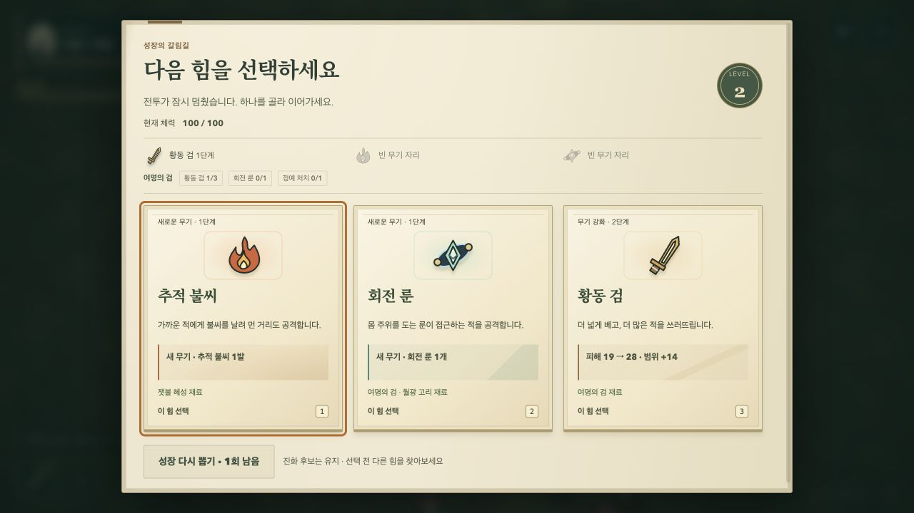

# 여정 준비·성장·장비 안내 개선

2026-10-20. 기존 2D 숲과 양피지 UI를 유지하면서 출발 준비 → 전투 → 성장 선택의 정보 연결을 개선한다.

## 문제와 변경

- 기념품과 서약이 긴 준비 목록 아래에 묻혀 있었다. 내부 패널 상단에 현재 선택을 보여주는 바로가기를 고정하고, 누르면 해당 제목으로 스크롤·키보드 포커스를 이동한다.
- 작은 화면에서 다음 해금 목표가 보이지 않았다. 출발 버튼 위에 명시적으로 지정한 수집 목표, 미해금 동료, 미완료 도전 보상 순서로 하나를 보여준다. 도감의 정확한 항목으로 연결하며 열람만으로 보상을 지급하지 않는다.
- 성장 카드와 현재 빌드를 비교하기 어려웠다. 세 무기와 실제 진화 조건을 함께 표시하고, 아직 필요한 강화에는 진화 재료 표시를 붙인다. 준비가 끝난 진화와 이미 완료한 진화를 구분한다.
- 일시정지는 텍스트 요약만 제공했다. 현재 무기의 그림, 강화 단계, 선택한 전문화와 진화 충족 상태를 장비 카드로 보여준다. 전투 HUD의 무기를 누르면 전투를 멈추고 해당 장비로 포커스를 옮긴다.
- 일시정지의 접을 수 있는 설정에서 효과음, 피해 숫자, 모션 감소를 조정한다. 설정 변경이나 장비 열람은 전투 시간·강화·해금에 영향을 주지 않는다. 시스템 모션 감소가 켜진 경우 이를 유지한다.
- 첫 5초의 이동·일시정지 안내와 고유 능력 준비 상태를 보강한다. 추가적인 전투 범위 도형이나 점멸은 넣지 않는다.

위 화면은 로컬 인앱 브라우저에서 일반 이동과 처치로 레벨 2에 도달한 장면이다. 진화 조건을 현재 장비와 성장 후보 사이에서 비교할 수 있다.

## 유지하는 규칙

공격·피격 판정, 적과 보스 일정, 보상 수치, 저장 프로필 형식은 그대로다. `ash-profile-v1`과 기존 `ash-sound`는 유지하고 표시 설정만 `ash-preferences-v1`에 분리한다. 저장이 차단되면 현재 창에 설정을 적용하고 저장 실패를 알린다.

전체 문서는 스크롤하지 않는다. 로비 목록·장비 안내만 내부 스크롤하고 출발·재개는 고정한다. 모바일 세로 화면에서는 미획득 장비 카드를 생략하며 성장 화면에는 빈 무기 자리를 표시한다. 키보드 드롭다운의 Esc/P는 전역 재개 단축키가 가로채지 않는다.

## 검증

로컬 전체 검사: 단위 163개, 브라우저 146개 통과. Pages production smoke에서 기본 주소와 `/survivor/`의 실행 및 기존 저장 연속성을 확인했다.

- 순수 함수 검사: 조건 충족/초과/진화 완료, 공용 재료, 목표 우선순위, 읽기 과정의 무변경, 설정 저장 격리와 차단 복구.
- 브라우저 검사: 1280×720, 390×844, 320×568, 740×360에서 바로가기·도감 연결·고정 버튼·장비 포커스·일시정지 유지·설정 재접속.
- 실제 Canvas 그리기 검사: 피해 숫자를 꺼도 타격 이펙트가 남고 시뮬레이션이 변경되지 않는지 확인.
- 기존 전투·보스·저장·레이아웃 회귀, Pages 하위 경로의 두 진입 주소와 저장 연속성 검사.
- Codex 인앱 브라우저에서 데스크톱/모바일 렌더링과 일반 입력 흐름 확인. 자동화 검사는 물리 휴대폰 성능이나 사람 대상 재미 검증을 대신하지 않는다.

새 UI 글자를 포함하도록 기존 OFL 한글 폰트를 다시 서브셋했다. 이미지·외부 런타임 의존성은 추가하지 않는다.
