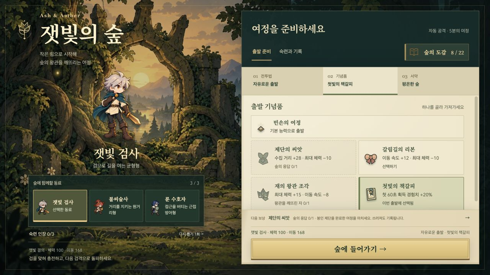
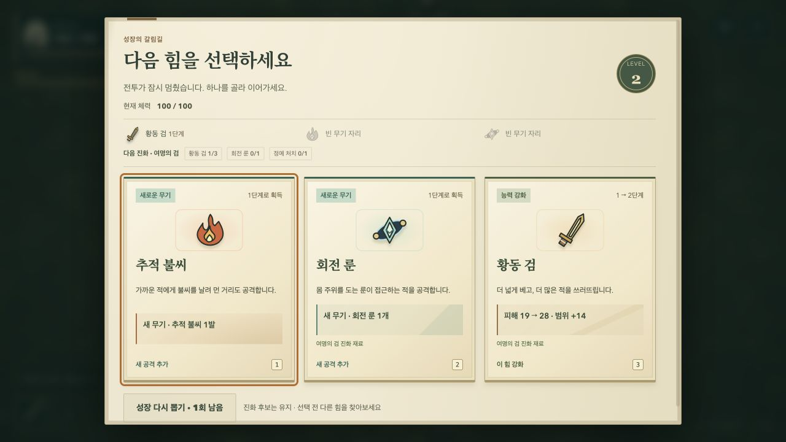

# 준비와 성장 선택의 정보 구조 개선

2026-10-20. 기존 숲·동료·양피지의 시각 방향을 유지하면서, 긴 목록과 중복 안내를 줄이는 UI/UX 개편이다.

## 벤치마크와 적용 판단

공식 개발사 소개와 Steam 배급 페이지를 확인했다. 아래의 ‘적용’은 각 게임의 화면을 그대로 복제한 것이 아니라, 공개된 플레이 구조를 이 게임에 맞게 해석한 설계 판단이다. 외부 게임의 이미지·폰트·아이콘은 사용하지 않았다.

| 공식 자료에서 확인한 구조 | 이번 게임에 적용한 판단 |
| --- | --- |
| [Vampire Survivors](https://store.steampowered.com/app/1794680/Vampire_Survivors/)는 적은 수의 공격 무기를 먼저 모아 하나씩 강화하고 다양한 강화 경로를 실험하도록 안내한다. | 성장 카드에서 새 공격 획득과 기존 강화의 차이를 명시한다. 실제 단계 변화·피해 변화가 선택의 중심이다. |
| [Brotato](https://store.steampowered.com/app/1942280/Brotato/)는 최대 6개 무기와 캐릭터 특성으로 빌드를 구성하고, 웨이브 사이 상점에서 다음 전투를 준비한다. [개발사 프레스킷](https://blobfishgames.com/press/brotato/)도 같은 구성을 설명한다. | 준비를 전투법·기념품·서약의 세 제한된 결정으로 나눈다. 현재 선택은 계속 보이고, 편집할 목록 하나만 연다. 상점·화폐·추가 무기 슬롯을 도입하지는 않는다. |
| [Halls of Torment](https://store.steampowered.com/app/2218750/Halls_of_Torment/)는 퀘스트 기반 메타 성장과 다음 여정에 가져갈 장비를 소개한다. | 다음 목표·조건·도감 연결에 같은 계산 기준을 사용한다. 기록 화면과 출발 안내가 서로 다른 목표를 말하지 않도록 한다. |

## 바뀐 흐름

- 준비 상단의 단순 스크롤 바로가기를 실제 탭으로 교체했다. 선택값은 탭에 남고 목록만 내부 스크롤한다. 선택 후 같은 탭·스크롤·포커스를 유지하며, 도감에서 돌아와도 준비를 이어갈 수 있다.
- 시작 전승 선택을 먼저 보여 주고 동료의 상세 전투 설명은 펼쳐 읽는다. 긴 기념품·서약 목록을 동시에 읽을 필요가 없다.
- 미발견 전투법에 시작 무기 3단계와 성장 선택이라는 발견 조건을 명시했다. 기념품의 해금 조건은 비활성 상태에서도 읽을 수 있는 명도로 표시한다.
- 하단에는 하나의 다음 목표와 출발 버튼을 유지한다. 데스크톱에는 출발 능력·구성을 짧게 요약하고 모바일은 상단 선택값으로 대체해 목록 높이를 확보한다.
- `campMission`이 명시 목표 → 미해금 동료 → 미완료 도전 → 미발견 항목 → 숙련의 순서로 목표를 결정한다. `nextGoal`도 같은 결과를 사용한다.
- 성장 카드의 결정 종류를 글자와 색으로 함께 구분한다. 진화는 ‘조건 완성 / 지금 진화하기’, 전문화는 ‘이번 판 한 갈래’, 새 무기는 ‘1단계로 획득’, 강화는 실제 현재 → 다음 단계, 회복은 생존 효과를 표시한다. 후보 순서·추첨·효과는 그대로다.
- 성장 상단은 다음 진화 하나만 안내한다. 후보에 진화가 있으면 반복 재료 칩 대신 완성 안내를 보인다. 카드별 재료 안내도 같은 진화에만 연결한다.
- 모바일 성장 카드의 과도한 최소 높이를 없애 일반적인 세 후보를 한 화면에서 비교하도록 했다. 더 짧은 화면의 후보는 내부 스크롤로 접근한다.
- 일시정지는 현재 무기를 먼저 보여 주고 부가 효과·성장 기록은 접었다. HUD 장비 클릭으로 해당 장비에 바로 포커스하는 흐름을 유지한다.

- 일반 플레이에서 확인한 경험치 보너스의 부동소수점 잔여 자릿수는 HUD에서 소수 한 자리까지만 표시한다. 실제 경험치 계산값은 유지한다.

## 보존하는 계약과 검증

`ash-profile-v1` 저장 형식·해금 조건·기념품 효과·무기 수치·전투 시간·판정은 변경하지 않는다. UI 열람은 보상을 지급하거나 시간을 진행시키지 않는다. 전체 문서는 고정하고 긴 내용만 안에서 스크롤한다.

실제 인앱 브라우저에서 390×844 준비 화면과 일반 이동·처치로 도달한 레벨 2 성장 선택을 확인했다. 별도 자동 테스트는 320×568, 390×844, 640×360, 740×360, 1280×600, 1280×720의 고정 출발 버튼, 선택 유지, 도감 복귀, 키보드 탭 이동, 후보 분류, 진화 조건을 검증한다. 일반 플레이 확인과 개발 시나리오 검증은 구분한다. 인간 플레이어의 선택 속도·재방문 개선은 아직 측정하지 않았다.

로컬 검증: 단위 165개 통과. 전체 브라우저 149개 중 147개 통과 후, 새 진화 안내에 맞춘 기대값과 도감 복귀 포커스 대기를 수정했다. 해당 실패 항목과 새 경험치·키보드 검사까지 포함한 집중 검사 8개가 통과했다. Pages 빌드 및 두 진입 주소의 저장 호환성 검사를 통과했다. 배포 CI는 최종 브라우저 151개를 다시 실행한다.
