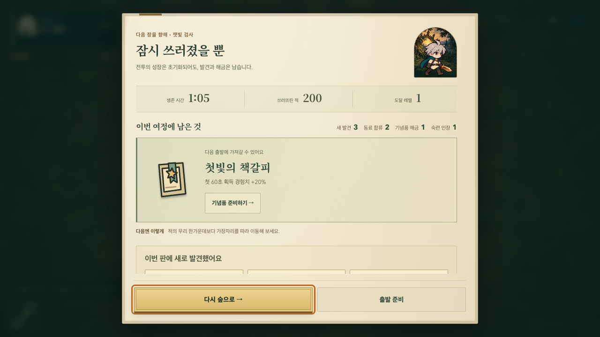
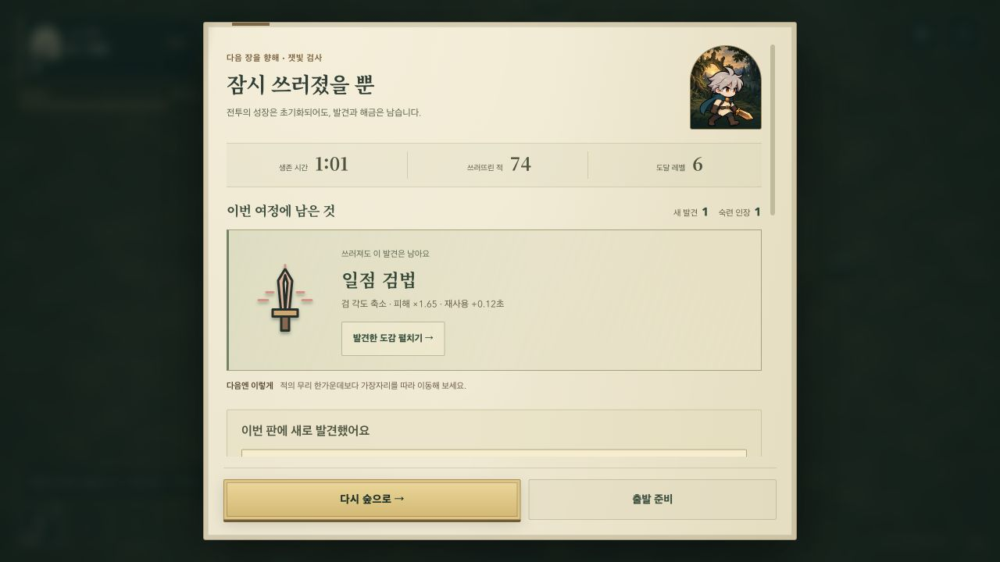

# 결과에서 다음 출발까지

2026-10-20. 준비·성장 화면 개편 다음으로, 한 판의 성과를 읽고 다음 선택으로 이어가는 결과 화면을 정리했다.

## 문제와 설계 판단

기존 결과는 큰 동료 그림, 제목, 통계, 장비 요약 다음에 새 발견·기념품·동료 해금을 보여주었다. 작은 화면에서는 다시 시작할 수 있어도 무엇이 남았는지 알기 어려웠다. 특히 기념품의 효과를 읽은 뒤 로비에서 해당 준비 목록을 다시 찾아야 했다.

[앞선 공식 자료 조사](./35-FOCUSED-PREPARATION.md)의 누적 성장·다음 전투 준비·퀘스트 기반 해금 구조를 이어 적용했다. 이번 화면은 자체 설계이며, 다른 게임의 결과 화면을 직접 관찰하거나 복제했다는 의미는 아니다. `player-experience-review`의 보상 명확성·다음 행동 연결 기준으로 다음을 선택했다.

- 결과 제목과 동료 그림은 짧은 머리말로, 생존 시간·처치·레벨은 한 줄의 기록으로 만든다.
- 실제 이번 판에 늘어난 새 발견, 동료, 기념품, 숙련 인장의 수를 함께 보여준다.
- 다음 출발에서 활용할 수 있는 보상 하나를 이름·그림·효과·행동으로 강조한다. 새 기념품 → 새 동료 → 새 발견 → 새 숙련 → 기존 다음 목표 순서다.
- 기념품 버튼은 해당 준비 탭과 카드로 이동한다. 열람만으로 장착하지 않는다. 동료·발견·목표 버튼은 해당 분류와 항목의 도감을 연다.
- 새 보상이 없는 판에는 그 사실을 알리고 다음 목표를 안내한다. 패배 시 실제 누적 피해가 가장 컸던 유형에 맞는 회피 팁을 덧붙인다.
- 다른 새 발견과 해금, 다음 빌드 실험은 이어 읽을 수 있다. 장비·성장 효과와 무기별 피해 통계는 펼쳐 읽는다.
- 재도전과 출발 준비는 고정하고 본문만 내부 스크롤한다. 재도전은 현재 준비로 바로 시작한다.

## 저장과 보상의 경계

보상 표시는 `recordRun`이 반환한 이번 판의 차이만 사용한다. 종료 화면을 다시 그릴 때는 기존 `game.resultRewards`를 사용하며, 새 기록 표시도 같은 캐시에 보관한다. 새 화폐·보상·해금 조건은 추가하지 않았다. 저장 키와 전투 수치도 그대로다.

이미 가진 발견은 새 보상으로 표시하지 않는다. 도감 열람, 준비 탭 이동, 숙련 확인은 동료·기념품을 자동 선택하거나 추가 능력을 주지 않는다. 실제 선택 후에만 저장·다음 출발에 반영한다. 저장 실패 경고는 결과 본문 상단에서 보인다.

## 검증 범위

단위 검사는 실제 기록 델타·중복 기록 방지·보상이 없는 목표 안내·피해 유형 팁·동료/발견 링크·숙련 인장 효과를 확인한다. 브라우저 검사는 1280×720, 390×844, 320×568에서 첫 화면의 보상 활용 버튼과 고정 재도전 버튼, 준비 탭·카드 포커스, 자동 장착 없음, 명시 선택 후 새로고침 저장을 확인한다. 740×360에서는 내부 스크롤과 고정 동작 영역을 확인한다.

320px에서 두 열 기념품 카드의 긴 문장이 카드 높이를 늘리는 문제가 있어 한 열로 바꿨다. 카드 포커스와 전체 화면 스크롤 없음도 다시 확인한다. 이 검증은 화면과 기능의 회귀 검사이며, 재방문율이나 재미의 개선을 입증하는 사용자 실험은 아니다.

위 이미지는 발견·동료·기념품·숙련 인장을 동시에 검증하는 개발 시나리오다. 실제 플레이 결과 수치나 신규 플레이어의 보상을 대표하지 않는다.

## 실제 조작과 최종 로컬 확인

인앱 브라우저 일반 플레이에서 잿빛 검사로 1분 1초, 74처치, 레벨 6까지 진행했다. 일점 검법을 처음 발견한 결과에 새 발견 1개·숙련 인장 1개가 표시되었고, 390×844에서도 확인했다. 결과 → 해당 도감 → 전승 준비 → 다음 판의 황동 검 1단계·일점 검법 적용까지 실제 버튼으로 이어 확인했다. 이전 테스트 저장을 사용한 로컬 플레이이며 새 계정의 첫 판은 아니다.

단위 검사 169개, 기존 결과·준비 집중 검사 10개와 마지막 보상·모바일·알림 검사 7개가 통과했다. Pages 빌드와 두 진입 주소의 저장 호환성 검사도 통과했다. 전체 브라우저 회귀 검사는 메인 배포 CI에서 실행한다. 다음 판 시작 시 이전 전투 알림의 텍스트와 표시 상태도 초기화한다.
