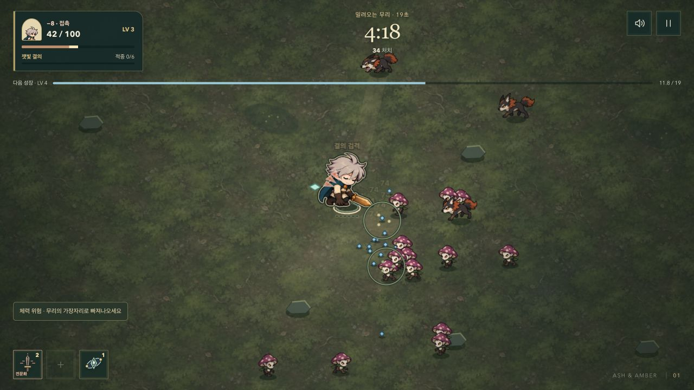

# 전투 HUD와 선택의 안전한 복귀

기존 [준비·성장 선택 방향](./35-FOCUSED-PREPARATION.md)을 이어 전투 중 정보의 위치와 선택 취소 동작을 다듬었다. 화면에 새 전장 표식이나 성장 재화를 추가하지 않는다.

## 확인한 문제와 반영

- 모바일 보스전에서 사건과 알림이 거의 같은 높이의 고정 좌표를 사용했다. 상단 HUD를 흐름 배치로 묶어 실제 내용 높이 뒤에 다음 안내가 놓이게 했다.
- 동료 고유 능력과 경험치가 두 번째 행을 나눠 쓰면서 모바일 경험치가 작은 칸에 갇혔다. 고유 능력은 체력 패널 아래로, 경험치는 전체 폭으로 옮겼다. 다음 레벨과 실제 경험치 수치를 함께 표시한다.
- 가로 화면의 보스 체력은 하단 조작부에서 상단 중앙으로 옮겼다. 시계는 우측 버튼 아래에 유지한다.
- 320×568에서는 보스와 활성 상자가 함께 있을 때 일시 알림을 숨기고 진행 중인 위험을 우선한다. 작은 보스 카드와 상자 안내는 캐릭터의 중앙 영역을 가리지 않도록 제한했다.
- 체력이 60% 미만일 때 회복 안내가 성장 목표를 잠시 대신한다. 회복하면 목표가 다시 나타난다. 초반 조작 안내는 14초 이후 화면과 접근성 트리에서 함께 숨긴다.
- 수락한 상자는 남은 저주 시간과 위험을 표시한다. 진행 중에는 보상 미리보기 버튼을 생략한다. 수락 전 미리보기와 일반 일시정지는 유지한다.
- 저주 상자에서 Esc/P는 포기로 처리되고 있었다. 이제 **나중에 결정하기**와 동일하게 전투로 돌아온다. 상자는 기존 만료 시각까지 다시 열 수 있고 보상 후보는 바뀌지 않는다. **이번 판의 상자 포기**를 눌러야 명시적으로 포기한다.
- 성장 다시 뽑기 후 포커스를 실제로 새로 등장한 후보로 옮긴다. 고정된 진화 후보와 사용 횟수가 0이 된 비활성 버튼에 포커스가 남지 않는다. 내부 목록도 포커스 위치로 이동한다. 유물 선택에도 전투 정지·재개를 안내한다.
- 740×360 성장 화면은 긴 상단 제목 영역 때문에 후보의 이름까지 잘려 있었다. 제목·체력·정지 안내를 압축하고 다시 뽑기 버튼은 고정해, 카드 목록에 더 많은 높이를 배정했다.

## 동작 경계

저장 키, 해금 조건, 공격 수치, 보스 시각, 상자의 18초 저주와 225초 미수락 만료 규칙은 유지했다. 보류는 보상 재추첨이나 무료 획득이 아니다. 도감·전승·기념품 기록도 바꾸지 않는다.

새 `combat-ui.css`는 전투 HUD의 흐름과 화면 크기별 배치를 담당하며 기존 숲·황동 시각 언어를 사용한다. 루트와 `/survivor/` 진입 문서는 같은 구조를 유지한다.

## 검증

단위 검사로 상자 보류 시 시간 정지, 후보 보존, 재열기, 이후 수락을 검증했다. 브라우저 검사는 실제 버튼과 Esc/P를 통한 보류·재열기·명시 포기·수락 후 18초 완료, 다시 뽑기 포커스를 확인한다.

1280×720, 390×844, 320×568, 740×360에서 보스·활성 저주·회복·알림을 동시에 표시한 개발 시나리오로 HUD 교차, 화면 밖 넘침, 조이스틱 가림을 검사한다. 짧은 세로 화면에는 중앙 캐릭터 공간 검사도 포함한다. 기존 보스 패턴, 터치 이동, 회복 열매, 긴 피격 문구, 소수 경험치 검사도 실행한다.

인앱 브라우저에서는 기존 로컬 테스트 저장으로 일반 플레이를 진행했다. 레벨 3까지 성장하고 다시 뽑기 → 새 후보 포커스 → 무기 선택 → 전투 재개 → 일시정지를 직접 확인했다. 아래 이미지는 시나리오 주입 없이 플레이한 전투다. 재미나 생존율이 개선되었다는 정량 실험은 아니다.

로컬 단위 검사 170개와 해당 HUD·선택·터치·보스·회복 집중 브라우저 검사가 통과했다. Pages 빌드와 루트·`/survivor/` 두 진입점의 자산 로딩, 저장 유지, 개발 훅 제거 검사도 통과했다. 전체 브라우저 회귀 검사는 메인 배포 CI에서 실행한다.

