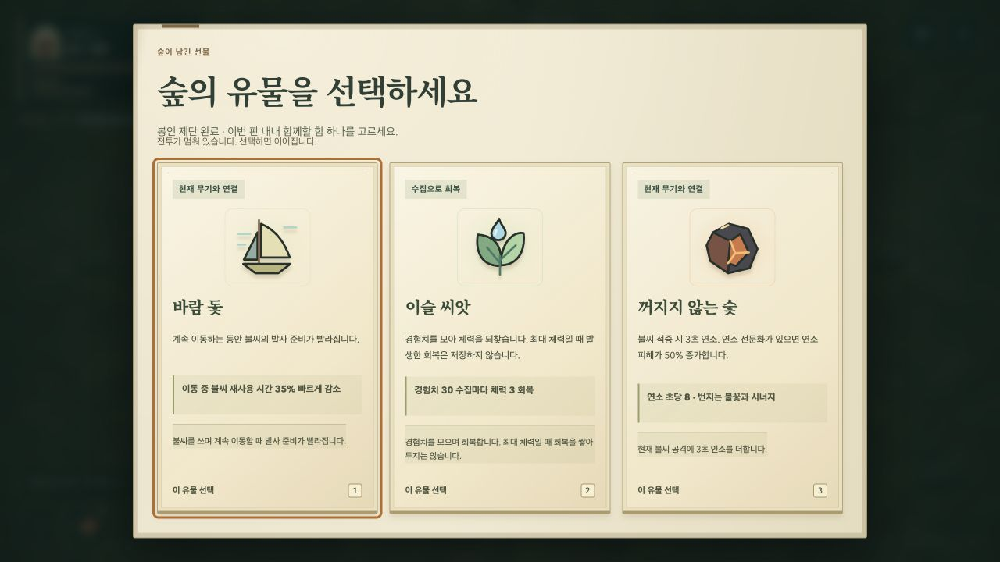
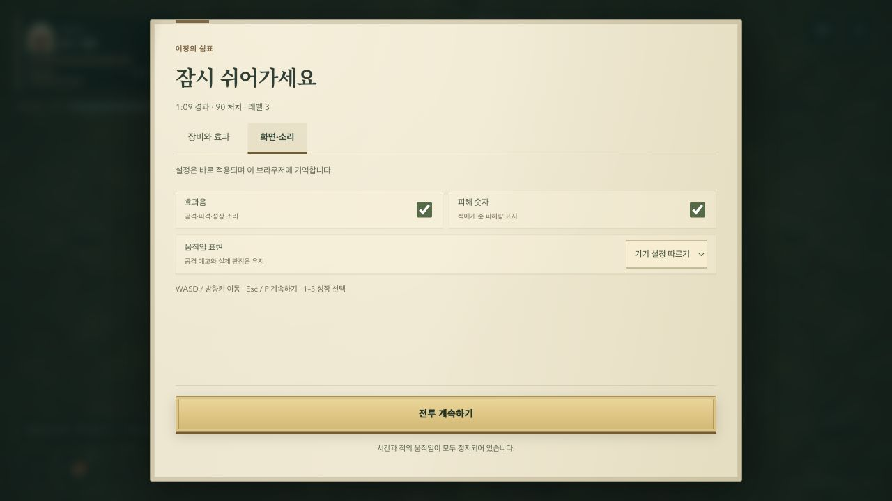

# Journey continuity and explicit choices

## Problems found through play and flow review

The caster's ordinary departure, early growth, altar preview and earned relic selection were played in the Codex in-app browser. Opening screen/sound settings required scrolling below the equipment journal. Results lost their return path when opening a discovery in the codex. The camp journal lost expanded records and reading position across navigation. Deferred events did not explain their existing expiry.

## Changes

- Pause has equipment and screen/sound tabs above an internal scroll area. Resume stays fixed below it. Equipped weapons appear first with their actual attack description. Arrow keys and Home/End move between tabs; HUD weapon inspection always opens the equipment tab.
- Sound reports unavailable browser storage just like the other display preferences; current-session settings still apply.
- A codex opened from results returns to the same run, reward summary, expanded battle notes, reading position and initiating control. Explicit preparation still leaves the result. The existing run ID prevents duplicate recording.
- Camp navigation preserves the expanded journal sections and the reading position of each preparation section and journal.
- The next-challenge summary names its actual reward, rather than putting the currently equipped keepsake beside the next objective.
- Altar/chest UI displays remaining time until the existing 225-second deadline. Completed objectives and accepted curses keep their existing rules. Expired objectives give one brief announcement.
- Relic cards show current-weapon compatibility, missing-weapon requirements or synergy before their artwork and description.

The save schema, damage values, rewards, enemy pacing and boss deadline are unchanged.

## Verification

Browser checks exercise result/codex round trips at 1280×720, 320×568 and 740×360, repeated reward inspection, preserved records and scroll, keyboard tabs, sound storage failure, paused time, chest expiry and accepted-curse completion. Existing production checks cover both entry URLs and saved-progress continuity.

Local verification passed: 171 unit tests, 171 browser tests, the Pages build and both production entry checks. Independent static review found no further actionable regression. A fast mobile result/codex round trip exposed a delayed focus callback after its screen had closed; a screen guard fixed it and the repeated round-trip test now passes.

An ordinary caster run reached the altar and earned its three offered relics at about 1:09 / 90 kills / level 3. It continued through the first champion, low-health growth, fruit recovery and evolution, ending in defeat at 2:08 / 233 kills / level 9. Its new discovery was opened in the codex and the same result was restored through the visible return control. No scenario or time skip was used for the screenshots below. The local profile already had unlocked companions and the first-light bookmark. These observations do not establish game balance, audio quality or physical-phone performance.

