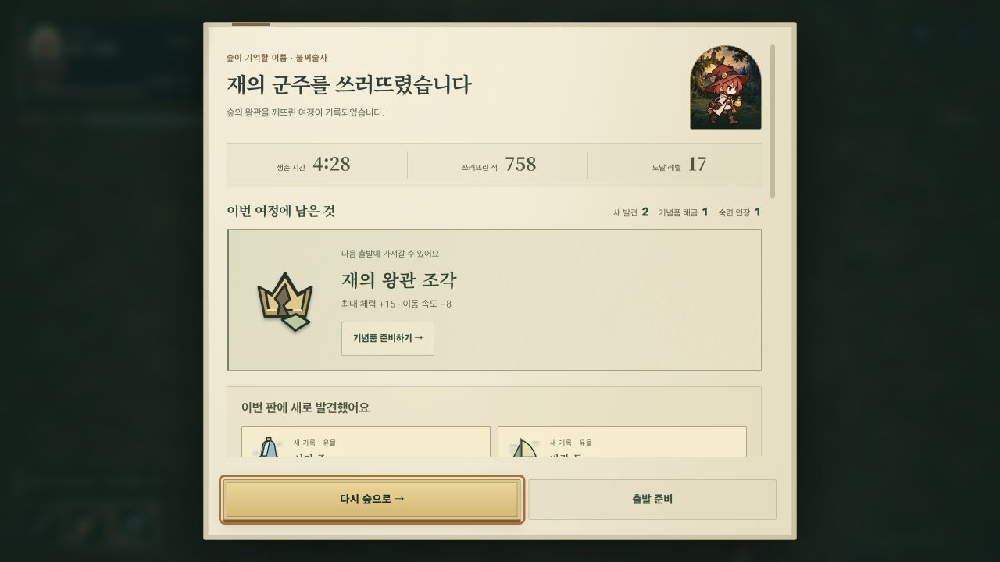
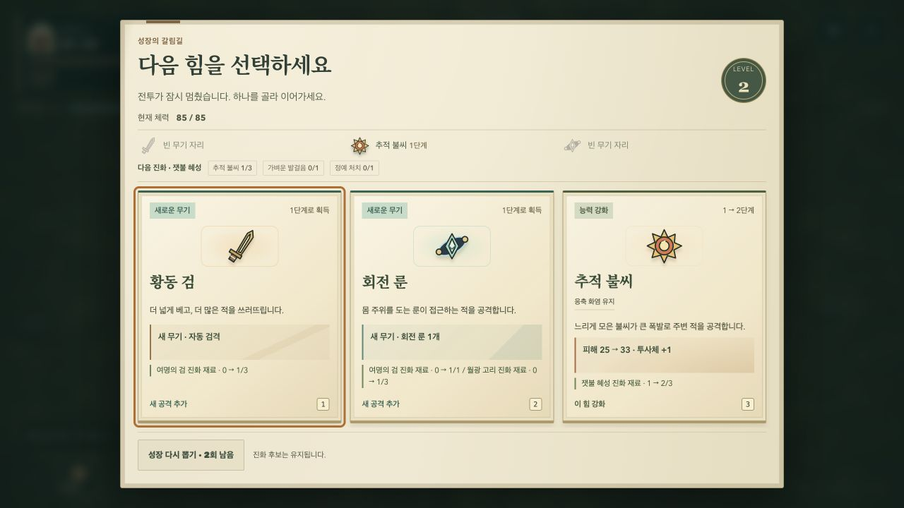
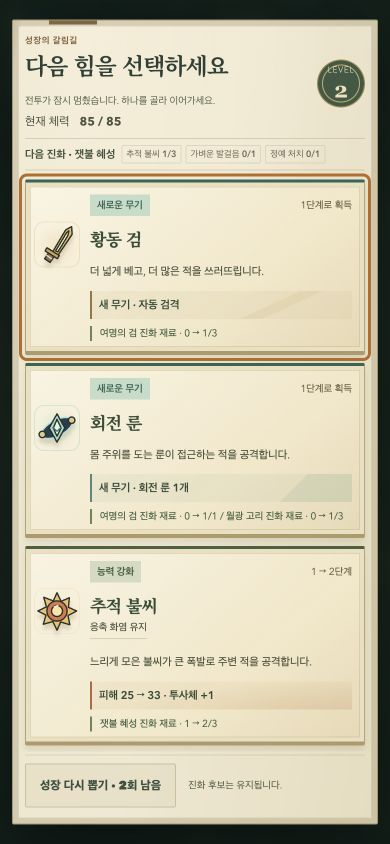
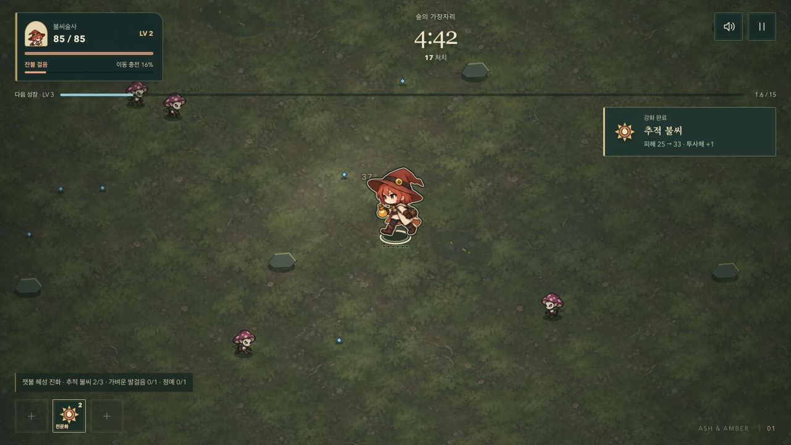
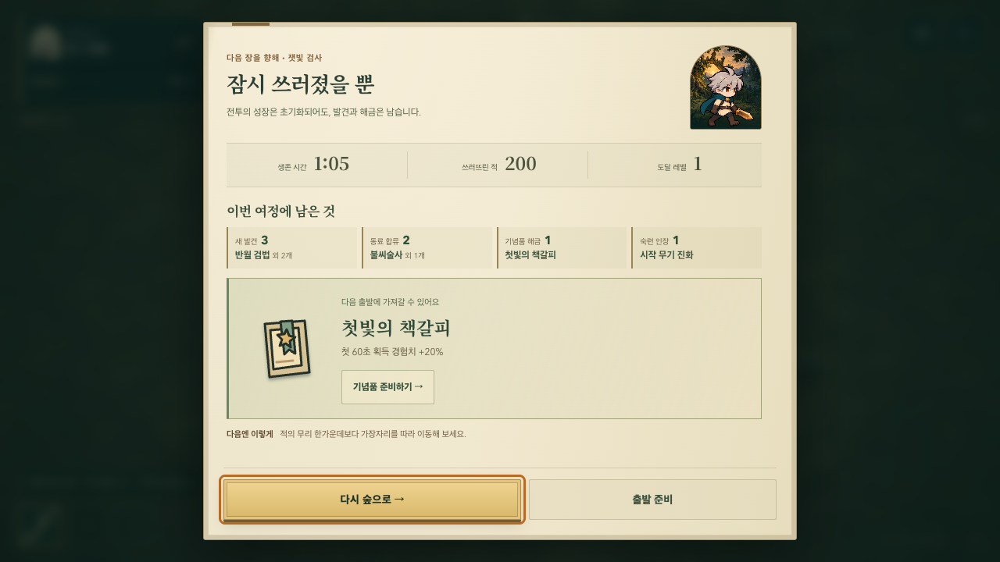

# Choices and earned rewards

## Ordinary play, from departure to victory

The game was played manually with keyboard movement, normal growth choices and ordinary pauses in the Codex in-app browser. No QA scenario, time skip, invulnerability override or automated steering was used for these runs.

- Ash's first run ended at 1:15, 98 kills and level 6.
- Ember's next run defeated the sovereign at **4:28, 758 kills and level 17**. The existing local profile supplied the unlocked caster, concentrated-fire inheritance and First Light Bookmark.
- The successful run completed the altar and chest curse, chose Wind Sail and Frost Bell, evolved Ash Comet, used healing fruit and avoided charge/thorn patterns through the enraged phase.
- Victory recorded two new relic discoveries, the crown keepsake and the caster's final mastery seal. Opening the earned relic in the codex and returning restored the same result. No browser errors or warnings were captured.

This is evidence of a completed ordinary run, not a fresh-save balance study, audio-quality assessment or physical-phone performance test.

## Friction found and fixed

1. **Choices grew below the screen.** At 1280×720, repeated copy and oversized card art pushed reroll below the comfortable reading area. Growth and relic panels now keep their header and reroll fixed, with only the card list scrolling. Cards use smaller art, shorter vertical spacing and explicit numerical changes. Mobile retains one column; short landscape retains three columns inside a bounded list.
2. **A material's contribution was easy to miss.** Cards now show progress for every relevant unfinished evolution, including secondary weapons. They announce next-growth eligibility only when the selected material completes all requirements, including an elite kill.
3. **Selecting a reward felt disconnected from receiving it.** A small illustrated receipt shows the selected name and the real before/after effect. It uses active game time, so pausing does not consume its reading time. Chained levels display the preceding selection inside the next choice panel instead of silently replacing it.
4. **Relic text repeated itself.** Each card now combines current-build compatibility with the numerical effect. Missing-weapon requirements and actual tradeoffs remain explicit; Frost Bell also clarifies that it does not slow the sovereign's attacks.
5. **Reroll feedback persisted into unrelated later levels.** “Candidates changed” now belongs to the current decision, not the cumulative reroll count.
6. **The result counted rewards without naming them at the top.** Earned categories now show an actual item/companion/seal name and the remaining count, with a brief staggered reveal. Detailed discoveries remain below. Preparation remains an explicit action and grants nothing when viewed.
7. **The boss appeared safe while its thorns were still moving.** The HUD now reports lingering thorns during caster recovery. A new windup and active charge retain priority over that message.

Danger notices precede the receipt. On a short phone with both a boss and active contract, their warnings take priority and the transient receipt is omitted. All reward reveals respect reduced motion. Combat values, attack/movement clocks, loot rules and save format are unchanged.

## Verification

Focused checks cover real comparison values without mutation, secondary evolution recipes, lingering-thorn caption priority, earned deltas without repeat grants, chained choices, pause-aware receipts, restart cleanup, fixed reroll, and reward/warning layout at 1280×720, 390×844, 320×568 and 740×360.

The short-phone result initially clipped the preparation button; reducing result spacing restored the complete button without shrinking its touch target. Independent review identified the chained-level receipt loss, which is now covered by the surplus-XP browser case.

Local verification passed: 174 unit tests, 180 distinct browser scenarios across the full and focused runs, the Pages build and both production entry checks. One full-suite case was interrupted by Vite reloading during the final edit; its isolated rerun passed. The final independent review found no remaining actionable regression.

The result screenshot below uses the development-only `record-experiment` fixture to exercise several simultaneous reward categories. It is not presented as the manually played victory above.

