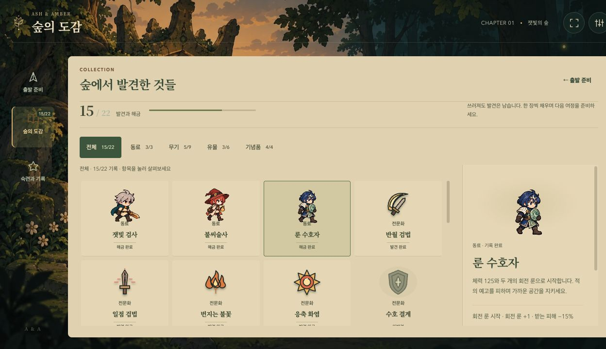
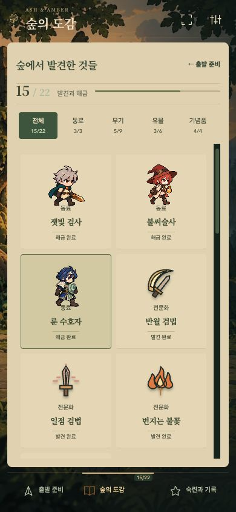
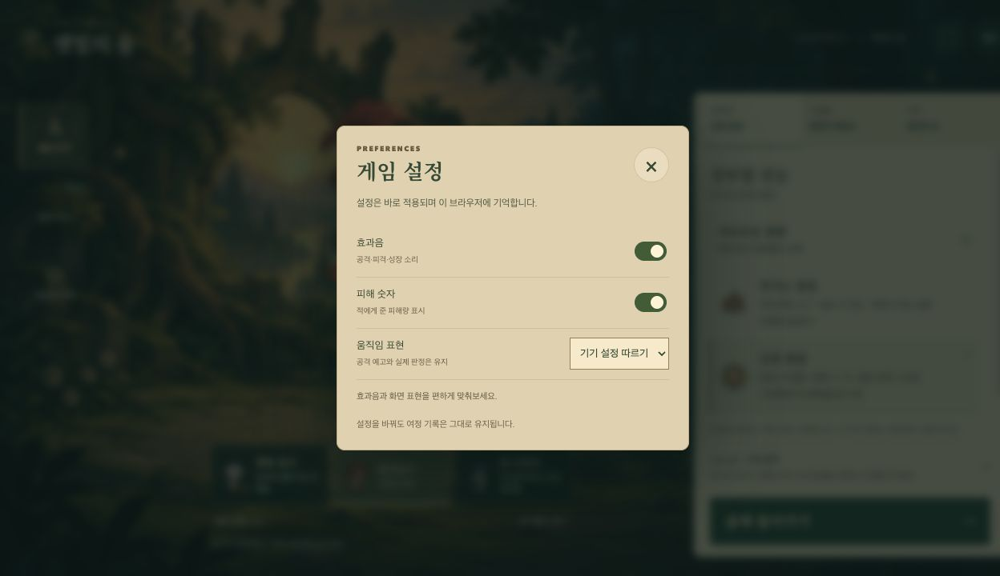

# Game app shell — character, equipment, collection

## Intent

Replace the lobby's large heading, duplicated explanations and heavily framed equipment form with a compact, persistent game interface. Keep the established forest illustration, companion artwork and journal palette. The work changes presentation and navigation, not combat balance, discovery requirements or the save format.

## Delivered behavior

- A compact identity header keeps settings and supported fullscreen controls available in preparation, records and the codex. Fullscreen reports a rejected request and follows the browser's actual fullscreen state.
- Desktop navigation occupies a left rail; portrait phones use a fixed bottom bar. The companion gets a larger stage, while preparation occupies one restrained paper surface. The next objective and departure action remain outside the editor's scrolling region.
- Combat style, keepsake and vow keep their selected values visible. Equipment is presented as readable rows with artwork and a restrained selected marker; repeated borders, frames and headings are removed.
- The lobby retains the first collection milestone: three distinct combat discoveries unlock the First Light Bookmark. Its real count stays in navigation and the reward effect is visible in the collection.
- The collection shares the same header and navigation. Desktop shows index and detail side by side. Phones open on the collection index, drill into an item, and return focus to that item. Opening a condition from the lobby still leads directly to its detail.
- The lobby settings dialog uses the same persisted sound, damage-number and motion preferences as the pause screen. It provides an explicit keyboard focus loop, Escape/close, inert background and focus restoration.
- Returning from the codex restores its initiating mission or navigation control. Preparation disclosures and reading positions are stored separately per editor; journal disclosures no longer replace preparation state.
- Screen changes use a short 180 ms content entrance. Persistent headers stay still, repeated selection renders do not replay the screen entrance, and both the system and in-game reduced-motion settings disable it.

## Evidence

The images below were captured in the Codex in-app browser from the local application. The existing local save had three companions and 15/22 collection entries from prior verification; these are not the defaults of a new account. No progress was granted by this UI change.

| Mobile preparation | Mobile collection index |
| --- | --- |
|  |  |

## Verification

Actual in-app browser inspection covered 1280×720, 390×844, 320×568 and 640×360, including starting an ordinary run, keyboard movement and pausing at 0:27 / 21 kills. This pass did not claim another ordinary boss clear. The new layout and navigation were also tested automatically at 1280×600 and 740×360.

Focused regression checks: 15 preparation/portrait/reading-position cases passed. Eight settings, fullscreen and collection cases passed after fixing a native-dialog focus dead stop, a list-return focus race and a header entrance animation that moved a fixed heading.

Full unit/browser regression and the GitHub Pages production smoke run are recorded in the release validation below. Browser scenarios include controlled development fixtures and must not be described as an ordinary five-minute boss victory. The previous ordinary boss victory is documented in [39-CHOICES-AND-EARNED-REWARDS.md](39-CHOICES-AND-EARNED-REWARDS.md).

Local release validation: 174 unit tests passed. The 185-case browser sweep found two failures (the removed initial collection hint and a default-focus race); both were corrected and the 27 related cases passed on the final behavior. The production smoke also passed for both entry URLs, with no page errors or failed asset requests. CI reruns the entire suite before publishing Pages. An independent review found no remaining actionable issues.

## Boundaries

This is a browser game with an app-oriented interface. It does not add installation, offline caching, accounts or cloud synchronization. Fullscreen availability depends on the browser; the viewport-constrained layout works without fullscreen. Browser storage remains the source of preferences and progress.
