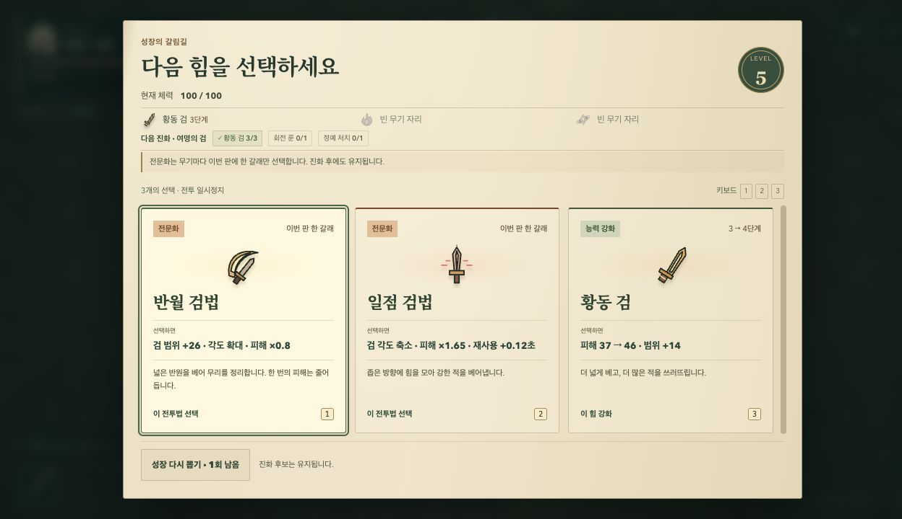
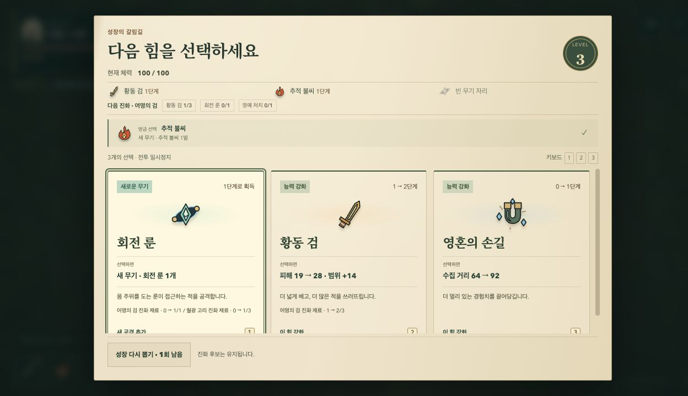
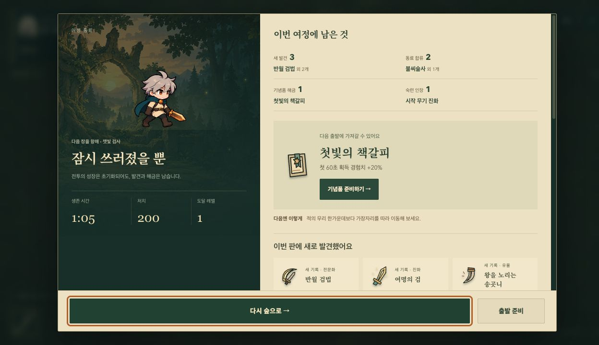
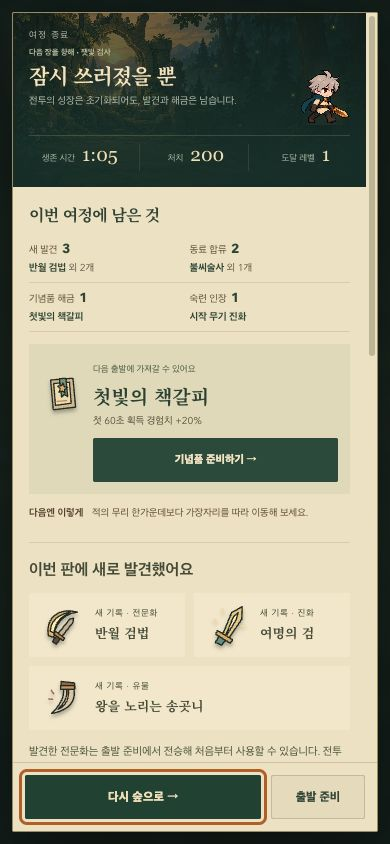
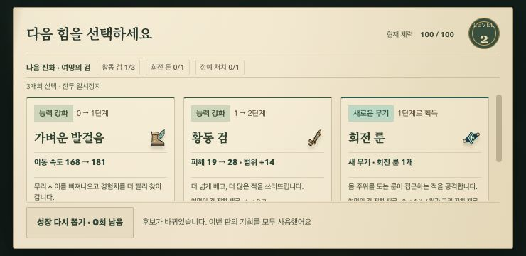

# Decisions and the return to camp

Continue the established forest, paper and brass direction through growth, relics and the end of a run. This pass changes presentation; weapon rules, reward eligibility, saves and progression stay the same.

## Changes

- Choice cards use a single restrained edge instead of multiple inset frames. The actual stat change appears before supporting prose, while specialization tradeoffs and evolution requirements remain available. Keyboard focus is visible and the existing 1–3 shortcuts have a common hint.
- Consecutive levels carry an illustrated receipt of the previous choice. Recovery, new weapons and specialization also get distinct receipt accents, alongside their existing explicit labels.
- Choice rows retain their full content height. Narrow and short screens scroll the list, with reroll outside it. A regression assertion catches cards whose content is clipped inside the button.
- Desktop results put the companion, outcome and run statistics beside an earned journal. Portrait phones stack a compact summary above the journal; short landscape screens retain two columns. Retry and preparation stay outside scrolling content.
- Earned categories, the usable reward and its preparation shortcut have clear priority. Detailed discoveries and battle records remain accessible, including the existing return from the codex with focus, disclosures and reading position restored.

## Rendered evidence

These screenshots were captured in the Codex in-app browser from development fixtures. They demonstrate the actual interface, not an ordinary boss victory or naturally earned progress in this pass.

## Verification

An ordinary local run reached its first growth selection by moving and collecting XP. Controlled previews then covered long specialization cards, consecutive upgrades, recovery, relics and result states. Layouts were inspected at 1280×720, 390×844, 320×568 and 740×360.

The focused 21-case browser pass covered recovery values, choice overflow, fixed result actions, next-preparation shortcuts, codex return without duplicate rewards, and preview storage isolation. Subsequent focused checks cover the final card sizing and relic flow. The production build and both published entry routes are checked before release; GitHub CI runs the full unit/browser suite before deploying.

The first full CI pass found that a rerolled card occupied too little visible space at 740×360. The short landscape layout now reduces the header, keeps artwork beside the name and brings the actual effect into view. All seven focused reroll and card-overflow checks pass after the fix, including 320px portrait and 740px landscape; the in-app browser also verified the landscape reroll and focus.

For repeatable local visual inspection, `?preview=branch-sword`, `?preview=overflow`, `?preview=record-experiment`, `?preview=victory` and the other explicitly allowed preview scenes use a disposable profile. They neither read nor overwrite the player's saved progress. This entry is development-only; public builds ignore it and do not expose QA controls.
