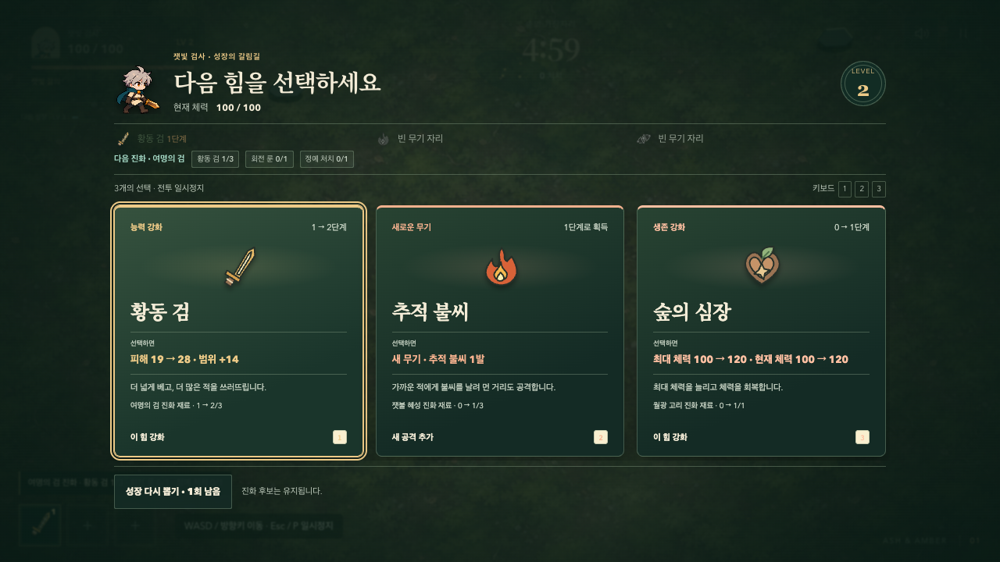
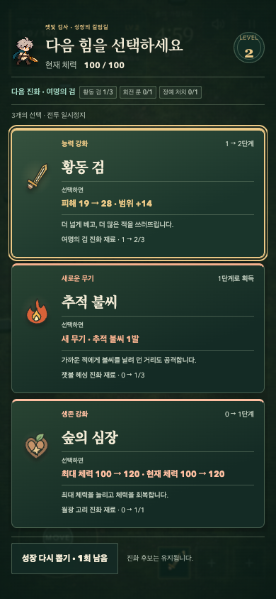
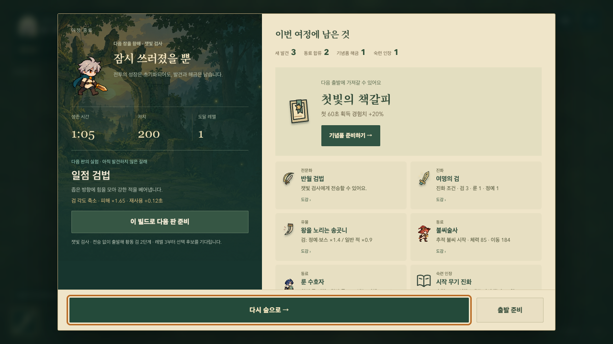

# Field decisions and the next departure

## Player feedback

Larger attacks were directionally right, but the player still found the game's
frontend and overall UI/UX unsatisfying. Another combat-effect pass would not
answer that feedback. This pass keeps the illustrated forest, companion art,
accepted lobby navigation and preparation rules, and changes the field decision
and return-to-play presentation.

## Audit

Scope: ordinary lobby/departure, growth and specialization, relic selection,
field HUD, outcome and collection/preparation returns. Inspected in the in-app
browser and against `main.js`, `camp.js`, `field-guide.js`, `folio.css`,
`choice-ui.css`, `journey-finish.css` and `combat-ui.css`.

| Finding | Severity | Player effect | Change |
| --- | --- | --- | --- |
| Growth opens a nearly opaque paper document | 2 | Frequent upgrades visually disconnect the player from the fight | Transparent field wrapper, reduced backdrop blur, companion identity and current build remain visible |
| Effects, prose and recipe metadata compete | 2 | Comparing a new attack with a stat upgrade requires repeated reading | Large item name/art, stronger actual change, quieter explanation and recipe; type/family accents |
| Optional event controls dominate the HUD | 2 | A large preview button competes with the battlefield and warning messages | Compact objective with a separate 44px action; forest colors replace the unrelated purple button |
| Choice feedback appears remotely as another message | 2 | The connection between the selected item and equipped power is weak | Decorative artwork travels to the equipped weapon/status; the real choice and input resume immediately |
| The next build is below a long result journal | 2 | Players can miss a concrete reason to try another route | Wide results put the existing next-build control beside the summary; phones prioritize newly earned equipment first |

Severity is 0–4; none of these findings implies a blocked task or lost save.

The 15-principle review retained existing strengths: real health/effect previews
and pause state (status, recognition, perceptibility); one-click choices,
keyboard shortcuts and saved preparation (control, efficiency, forgiveness);
explicit branch commitment and truthful relic requirements (error prevention,
help, domain match); named controls, focus restoration and motion preferences
(accessibility, signifiers); storage warnings and result/codex recovery (error
recovery); and fixed viewport/internal scrolling (structure). The changes above
address recurring presentation and continuity friction (consistency, visual
hierarchy) rather than inventing missing mechanics.

## Delivered behavior

- Growth and relic decisions use the forest/pine combat palette. Paper remains
  the camp and collection journal. Evolution cards retain a distinctive gold
  treatment, and weapon families use matching warm/cool accents.
- The current companion appears in the decision header. A relic header names
  its completed encounter. Mobile and short landscape retain reachable choices
  and reroll controls inside the panel, with no outer page scrolling.
- Selection applies once, immediately. A pointer-inert, screen-reader-hidden
  artwork transfer is purely decorative. System and in-game reduced motion
  suppress it; it never delays movement, advances time or grants a reward.
- Desktop XP sits with character status instead of stretching across the field.
  Optional event text and its action share a compact row; danger and earned
  feedback retain separate presentation channels.
- Earned result items form a compact two-column inventory on large displays.
  The same next-build control moves with the responsive result layout, keeping
  keyboard focus and one recorded run. On a small phone, the newly earned
  keepsake and its preparation action remain ahead of the next experiment.

## Verification

The in-app browser checked 1280×720, 390×844 and 740×360 decisions, relics,
result-to-preparation and layout changes. An additional ordinary fresh-profile
opening was played through weapon rank 2, level-3 Duelist, the first swarm and
movement after both pointer and keyboard choices; there were no console errors.
The development relic/result scenes are disposable presentation fixtures, not
claimed ordinary chapter wins.

211 Node tests passed. The complete browser suite passed all 236 cases; after a
final desktop queued-growth icon sizing adjustment, the 13 affected choice,
internal-scroll, responsive-result and motion cases passed again. The final Pages
build and production checks passed both entries, saved-progress continuity and
asset loading. Independent review found two decorative-flight target issues;
both were fixed, with desktop/mobile endpoints and reduced-motion tests added.

A 320px result regression temporarily put newly earned equipment below the fold.
The responsive result placement now keeps earned equipment first on phones,
while wide results show the next build alongside the run summary. Resizing keeps
one control, keyboard focus and the same recorded run.

The lobby's locked-style hint also now reads the shared weapon-rank/level
constants instead of the obsolete rank-3 literal.

The earlier ordinary-rule combat verification remains documented in
[45-COMBAT-SPECTACLE.md](45-COMBAT-SPECTACLE.md).

The whole-run enjoyment objective remains open. These changes address the
player's frontend feedback; automated pass counts cannot establish that the
new presentation feels satisfying to the player.
