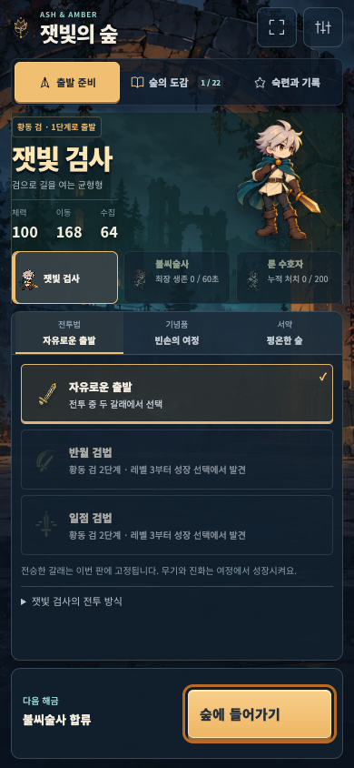
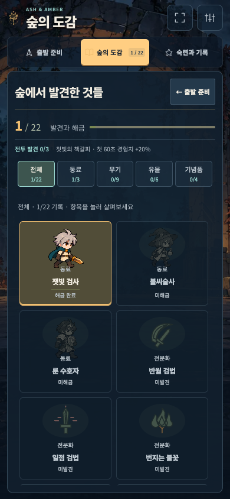
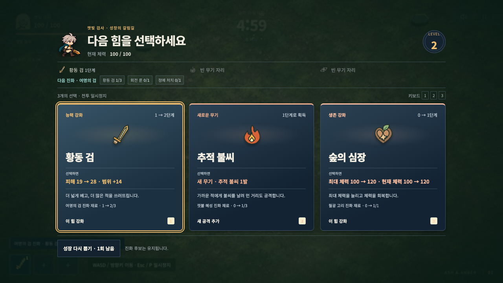
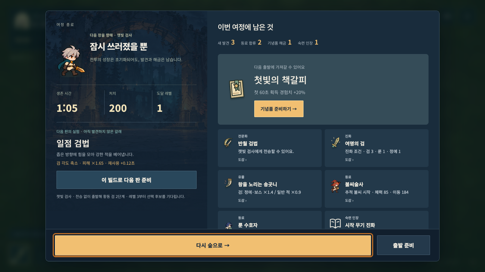

# The outpost: a new game interface from the lobby

## Direction

The player rejected the narrower field-choice improvement as insufficient:
the entire visual design needed to change, starting with the lobby. This pass
therefore replaces the previous green sanctuary / parchment / serif composition.
The existing cartoon companions, automatic survivor combat, navigation actions,
preparation choices and earned progression remain the game's content.

The new lobby is a character-selection stage at a ruined forest outpost at night.
The selected companion occupies the staging platform; name, role and real stats
sit to the left, the party roster to the right. Equipment is a horizontal dock
below the stage, with a separate departure command. Navigation moves to a compact
horizontal strip. This changes the page composition rather than just its colors.

## Shared visual rules

| Role | Value |
| --- | --- |
| Stone panel | `#111f2d` |
| Raised inventory surface | `#203243` |
| Primary text | `#f2ede1` |
| Supporting text | `#bec8d0` |
| Departure / selected equipment | `#f1bf71` |
| Rune / secondary progress | `#9cd9d2` |

- The self-hosted variable Noto Sans KR subset replaces the serif display face
  throughout the active UI. Heavy character names and primary commands contrast
  with quieter conditions and supporting text.
- Slated stone panels, inventory slots, clear selected edges and amber commands
  continue through collection, growth, relics, pause, settings, comparison and
  results. The combat clock is centered on wide displays.
- The new backdrop was generated as a background asset with no UI or characters;
  all interactive text and controls remain real HTML. Its composition leaves
  room for the party, selected companion and equipment. The WebP is about 283 KiB.
- Small portraits, warm/cool attack identities and the established enemy warnings
  remain readable against the new surfaces. No gameplay stats or rewards are
  granted by this presentation change.

## Responsive and interaction contracts

Desktop uses a stage, roster and equipment dock. Portrait phones place the roster
below the selected companion and keep equipment scrolling inside its region.
Short landscape retains the character stage beside an internal equipment editor.
Departure, settings, preparation tabs and collection remain reachable without an
outer page scroll. The existing focus restoration, keyboard paths, locked states,
result return, save schema and preparation memory are preserved.

An early 640px landscape render inherited the portrait header's single-column
placement, causing navigation to cover settings. The short-landscape header now
spans the frame and navigation clears the tools; pointer-driven regression cases
cover this geometry. Preparation checks now inspect the actual first option in
the new dock rather than a removed redundant section heading.

## Asset sources

- [Background and complete built-in generation prompt](../../../public/art/survivor/OUTPOST-PROMPT.md).
- [Font source, license and reproducible subsetting](../../../public/fonts/README.md).

## Rendered screens

The lobby and collection captures show a fresh profile. Growth, reward results
and the boss warning use controlled development scenarios; they are not evidence
of an ordinary boss victory. No debugging affordances ship in the production build.

## Verification

- Core Node checks: **211 passed** after the new markup/font integration.
- Final full Playwright suite: **240 passed (3.3 minutes)** with three workers.
- `GITHUB_PAGES=true npm run build`: passed.
- `GITHUB_PAGES=true npm run qa:survivor:production`: passed with no failures or
  browser errors, including both entry URLs, the new background/font and saved
  progress continuity. Final assets: `main-D2FPmknk.js`, `main-JLDq-pRM.css`.
- Layout checks cover 1280×720, 1280×600, 390×844, 320×568, 640×360 and 740×360:
  reachable departure/settings, no outer scroll, full roster visibility and
  actual equipment-dependent starting stats. Fixed-height mobile roster rows
  were replaced with intrinsic height so longer locked conditions fit.
- An independent visual review of desktop, short-height, portrait, collection
  and result captures found no blocking overlap or interaction issue.
- In-app browser play from an ordinary fresh start reached level 2 at full HP,
  acquired the real ember weapon and resumed movement immediately. Console
  warning/error logs were empty. This also exposed and fixed a remaining old
  dark current-weapon label in the growth header.

The whole-game enjoyment goal remains open: neither the new visual direction
nor automated tests establish that the player now finds the whole run satisfying.
